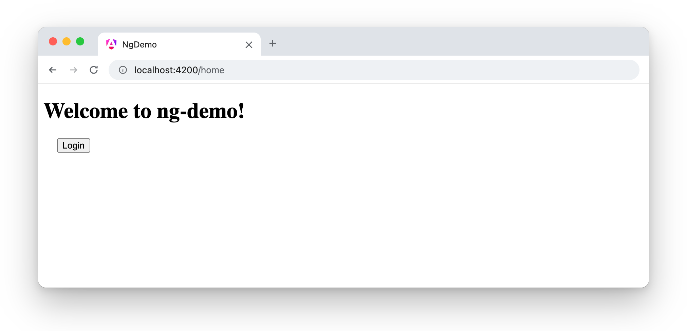
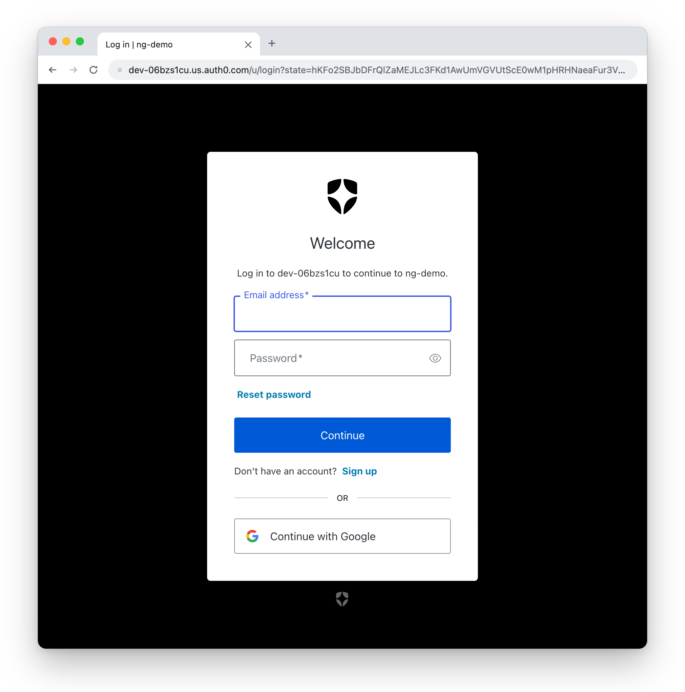

= Auth0 with Angular 22
:author: Matt Raible
:email:  matt@raibledesigns.com
:revnumber: 22.0.0
:revdate: {docdate}
:icons: font
:lang: en
ifdef::env-github[]
:outfilesuffix: .adoc
:caution-caption: :fire:
:important-caption: :exclamation:
:note-caption: :paperclip:
:tip-caption: :bulb:
:warning-caption: :warning:
endif::[]
:toc:
:toclevels: 2
:source-highlighter: highlight.js

This tutorial shows you how to add login and logout to the search and edit app from the link:README.adoc[Bare Bones Angular tutorial] with https://auth0.com[Auth0] and the https://github.com/auth0/auth0-angular[Auth0 Angular SDK]. Then, you'll protect the search and edit pages, and update your Cypress tests to log in.

.Source Code
****
The finished code is in the https://github.com/mraible/ng-demo/tree/auth0[`auth0` branch]. Each section below is one commit, and you can see all the changes in the https://github.com/mraible/ng-demo/compare/main...auth0[comparison with `main`].
****

== Prerequisites

* The app from the link:README.adoc[Bare Bones Angular tutorial]. If you didn't build it, clone the `main` branch and run `npm install`.
* A free https://auth0.com/signup[Auth0 account].
* The https://github.com/auth0/auth0-cli#installation[Auth0 CLI]. On macOS, you can install it with `brew install auth0/auth0-cli/auth0`.

== Create an Auth0 app

Log in to your Auth0 account with the Auth0 CLI.

[source,shell]
----
auth0 login
----

Then, create a single-page application. The callback URL is where Auth0 sends users after they log in, and the logout URL is where it sends them after they log out.

[source,shell]
----
auth0 apps create --name "Bare Bones Angular" --type spa \
  --callbacks http://localhost:4200/home \
  --logout-urls http://localhost:4200 \
  --origins http://localhost:4200 \
  --web-origins http://localhost:4200 \
  --refresh-token '{"rotation_type":"rotating","expiration_type":"expiring"}'
----

The `--refresh-token` option turns on https://auth0.com/docs/secure/tokens/refresh-tokens/refresh-token-rotation[refresh token rotation], so each refresh token can only be used once. That limits the damage if one is stolen. You'll see why you need refresh tokens in the next step.

Copy the domain and client ID from the output. You'll need them in the next step.

== Add login and logout

Install the Auth0 Angular SDK.

[source,shell]
----
npm install --save-exact @auth0/auth0-angular@2.13.0
----

Add `provideAuth0()` to `src/app/app.config.ts` with your domain and client ID.

[source,typescript]
.src/app/app.config.ts
----
import { ApplicationConfig, provideBrowserGlobalErrorListeners } from '@angular/core';
import { provideRouter } from '@angular/router';
import { provideAuth0 } from '@auth0/auth0-angular';
import { routes } from './app.routes';

export const appConfig: ApplicationConfig = {
  providers: [
    provideBrowserGlobalErrorListeners(),
    provideRouter(routes),
    provideAuth0({
      domain: 'dev-06bzs1cu.us.auth0.com',
      clientId: 'GlzZCL2mpQvStRsLVQvR57kyVGCqwKcy',
      authorizationParams: {
        redirect_uri: window.location.origin + '/home'
      },
      // Keep users logged in when they reload the page
      useRefreshTokens: true,
      cacheLocation: 'localstorage'
    })
  ]
};
----

By default, the SDK keeps tokens in memory, and when you reload the page, it checks if you're logged in with a hidden iframe on your Auth0 domain. Many browsers block the third-party cookies that iframe needs (in this project's CI, headless Chrome did), so you'd be logged out every time you reload. Setting `useRefreshTokens: true` and `cacheLocation: 'localstorage'` keeps you logged in by storing a refresh token in `localStorage` instead. If you created your app some other way, make sure refresh token rotation is turned on. You can check with `auth0 apps show <client-id> --json` and look for `"rotation_type": "rotating"`.

WARNING: Anything in `localStorage` can be read by JavaScript on your page, so this makes cross-site scripting (XSS) more dangerous. Angular escapes values in templates by default, and the strict CSP in `netlify.toml` blocks inline scripts, which both help.

NOTE: The domain and client ID aren't secrets. They're visible to anyone who uses your app, which is why single-page apps use the https://auth0.com/docs/get-started/authentication-and-authorization-flow/authorization-code-flow-with-pkce[Authorization Code Flow with PKCE] instead of a client secret.

Generate a home component.

[source,shell]
----
ng g component home
----

If this fails with "`Could not find an NgModule`", move `@schematics/angular` to the top of `schematicCollections` in `angular.json`, as described in the link:README.adoc#integration-test-the-search-ui[Cypress section of the main tutorial].

Update `src/app/home/home.ts` to inject Auth0's `AuthService` and add `login()` and `logout()` methods.

[source,typescript]
.src/app/home/home.ts
----
import { Component, DOCUMENT, inject } from '@angular/core';
import { AsyncPipe } from '@angular/common';
import { RouterLink } from '@angular/router';
import { AuthService } from '@auth0/auth0-angular';

@Component({
  imports: [AsyncPipe, RouterLink],
  selector: 'app-home',
  styleUrl: './home.css',
  templateUrl: './home.html',
})
export class Home {
  protected readonly auth = inject(AuthService);
  private readonly document = inject(DOCUMENT);

  login(): void {
    this.auth.loginWithRedirect();
  }

  logout(): void {
    this.auth.logout({ logoutParams: { returnTo: this.document.location.origin } });
  }
}
----

Then, change `src/app/home/home.html` to welcome the user by name with a link to search when they're logged in, and to show a *Login* or *Logout* button.

[source,html]
.src/app/home/home.html
----
@if (auth.user$ | async; as user) {
  <h2>Welcome, {{user.name}}!</h2>
  
<a routerLink="/search">Search</a>

}
@if (auth.isAuthenticated$ | async) {
  <button (click)="logout()" id="logout">Logout</button>
} @else {
  <button (click)="login()" id="login">Login</button>
}
----

Use `@if (auth.isAuthenticated$ | async)` with an `@else`, rather than checking for `=== false`. The `async` pipe returns `null` until Auth0 knows whether you're logged in, and the `@else` keeps the *Login* button from being replaced when the real value arrives. If it is, Cypress can fail with "`cy.click() failed because the page updated while this command was executing`".

Give the page some padding in `src/app/home/home.css`.

[source,css]
.src/app/home/home.css
----
:host {
  display: block;
  padding: 0 20px;
}
----

Add a route for the home component in `src/app/app.routes.ts` and make it the default.

[source,typescript]
.src/app/app.routes.ts
----
import { Routes } from '@angular/router';
import { Home } from './home/home';
import { Search } from './search/search';
import { Edit } from './edit/edit';

export const routes: Routes = [
  { path: 'home', component: Home },
  { path: 'search', component: Search },
  { path: 'edit/:id', component: Edit },
  { path: '', redirectTo: '/home', pathMatch: 'full' }
];
----

Replace the generated test in `src/app/home/home.spec.ts` with tests that mock `AuthService`.

[source,typescript]
.src/app/home/home.spec.ts
----
import { ComponentFixture, TestBed } from '@angular/core/testing';
import { provideRouter } from '@angular/router';
import { AuthService } from '@auth0/auth0-angular';
import { of } from 'rxjs';
import { Home } from './home';

describe('Home', () => {
  let fixture: ComponentFixture<Home>;
  let authService: { isAuthenticated$: unknown, user$: unknown, loginWithRedirect: unknown, logout: unknown };

  async function render(user?: { name: string }) {
    authService = {
      isAuthenticated$: of(!!user),
      user$: of(user ?? null),
      loginWithRedirect: vi.fn(),
      logout: vi.fn()
    };
    await TestBed.configureTestingModule({
      imports: [Home],
      providers: [provideRouter([]), {provide: AuthService, useValue: authService}]
    }).compileComponents();
    fixture = TestBed.createComponent(Home);
    await fixture.whenStable();
    return fixture.nativeElement as HTMLElement;
  }

  it('should show a login button when not authenticated', async () => {
    const compiled = await render();
    compiled.querySelector<HTMLButtonElement>('#login')?.click();
    expect(authService.loginWithRedirect).toHaveBeenCalled();
  });

  it('should welcome the user and show a logout button when authenticated', async () => {
    const compiled = await render({name: 'Nikola Jokić'});
    expect(compiled.querySelector('h2')?.textContent).toContain('Welcome, Nikola Jokić!');
    compiled.querySelector<HTMLButtonElement>('#logout')?.click();
    expect(authService.logout).toHaveBeenCalled();
  });
});
----

Your bundle is now larger than the 500 kB budget, so raise the warning threshold in `angular.json`.

[source,diff]
----
diff --git a/angular.json b/angular.json
--- a/angular.json
+++ b/angular.json
@@ -38,7 +38,7 @@
               "budgets": [
                 {
                   "type": "initial",
-                  "maximumWarning": "500kB",
+                  "maximumWarning": "600kB",
                   "maximumError": "1MB"
                 },
                 {
----

Your content security policy in `netlify.toml` only lets your app connect to itself. The Auth0 SDK gets tokens from your Auth0 domain, so add your domain to `connect-src`. Because you're using refresh tokens, the SDK doesn't need the hidden iframe, so you don't need to allow your domain in `frame-src`.

[source,diff]
----
diff --git a/netlify.toml b/netlify.toml
--- a/netlify.toml
+++ b/netlify.toml
@@ -14,7 +14,7 @@
 [[headers]]
   for = "/*"
   [headers.values]
-    Content-Security-Policy = "default-src 'self'; script-src 'self'; style-src 'self' 'unsafe-inline'; img-src 'self' data:; font-src 'self' data:; frame-ancestors 'none'"
+    Content-Security-Policy = "default-src 'self'; script-src 'self'; style-src 'self' 'unsafe-inline'; img-src 'self' data:; font-src 'self' data:; connect-src 'self' https://dev-06bzs1cu.us.auth0.com; frame-ancestors 'none'"
     Referrer-Policy = "strict-origin-when-cross-origin"
     X-Content-Type-Options = "nosniff"
     X-Frame-Options = "DENY"
----

When you deploy to Netlify, add your site's URL to your Auth0 app's allowed URLs, too. For example, run `auth0 apps update` and add `\https://<your-site-name>.netlify.app/home` to the callback URLs and `\https://<your-site-name>.netlify.app` to the logout URLs, allowed origins, and web origins.

Run `ng serve` and open `http://localhost:4200`. You'll see a *Login* button.

[[auth0-login-button]]
.Login button

Click it, and you'll be redirected to Auth0 to log in.

[[auth0-login-form]]
.Auth0 login page

NOTE: If your tenant's Google connection uses Auth0's development keys, Auth0 shows a red warning icon in the top-right corner of this page. It's been removed from the screenshot above. To make it go away, add your own Google client ID and secret to the connection, or disable it. See https://auth0.com/docs/authenticate/identity-providers/social-identity-providers/devkeys[Test Social Connections with Auth0 Developer Keys] for more information.

Sign up or log in, and you'll be redirected back to your app with a welcome message and a link to *Search*.

== Require authentication

Right now, anyone can go to `http://localhost:4200/search`. To require users to log in first, add Auth0's `authGuardFn` to the search and edit routes.

[source,typescript]
.src/app/app.routes.ts
----
import { Routes } from '@angular/router';
import { authGuardFn } from '@auth0/auth0-angular';
import { Home } from './home/home';
import { Search } from './search/search';
import { Edit } from './edit/edit';

export const routes: Routes = [
  { path: 'home', component: Home },
  { path: 'search', component: Search, canActivate: [authGuardFn] },
  { path: 'edit/:id', component: Edit, canActivate: [authGuardFn] },
  { path: '', redirectTo: '/home', pathMatch: 'full' }
];
----

Log out and go to `http://localhost:4200/search`. You'll be sent to Auth0 to log in, and then back to your app.

== Log in with Cypress

Your Cypress tests will fail now, because they can't get to the search and edit pages without logging in. Add a `signIn()` command to `cypress/support/commands.ts` that logs in on Auth0's login page and saves the session with `cy.session()`.

[source,typescript]
.cypress/support/commands.ts
----
declare namespace Cypress {
  interface Chainable {
    signIn(): Chainable<void>;
  }
}

Cypress.Commands.add('signIn', () => {
  // Log in once and reuse the session in every test, so the tests send fewer requests to Auth0
  cy.session('auth0', () => {
    cy.intercept('POST', '**/oauth/token').as('token');
    cy.visit('/');
    cy.get('#login').click();
    cy.env(['E2E_DOMAIN']).then(({E2E_DOMAIN}) => {
      cy.origin(E2E_DOMAIN, () => {
        cy.env(['E2E_USERNAME', 'E2E_PASSWORD']).then(({E2E_USERNAME, E2E_PASSWORD}) => {
          cy.get('input[name=username]').type(E2E_USERNAME, {log: false});
          cy.get('input[name=password]').type(`${E2E_PASSWORD}{enter}`, {log: false});
        });
      });
    });
    // The app goes to /home even if getting tokens fails, so check the token response and the Logout button
    cy.wait('@token', {timeout: 10000}).its('response.statusCode').should('equal', 200);
    cy.get('#logout').should('exist');
  }, {cacheAcrossSpecs: true});
});
----

This command uses `cy.origin()` to run commands on Auth0's domain, and `cy.env()` to read the credentials. `cy.env()` replaces `Cypress.env()`, which was removed in Cypress 16, and it only gives your tests the variables they ask for. The `{log: false}` options keep the username and password out of the Command Log.

`cy.session()` saves the cookies and local storage after the first login and restores them in later tests, and `cacheAcrossSpecs: true` shares them between spec files. Your tests log in to Auth0 once per run instead of before every test, which makes them faster and sends far fewer requests to Auth0, so they're less likely to hit its rate limits.

After logging in, the Auth0 Angular SDK exchanges a code for tokens and goes to `/home`. It goes to `/home` even if that exchange fails, so checking the URL isn't enough to know you're logged in. The command waits for the token request and makes sure it succeeded, then checks for the *Logout* button.

Update `cypress/support/e2e.ts` to call `signIn()` before each test. The first call logs in, and the others restore the saved session.

[source,typescript]
.cypress/support/e2e.ts
----
import './commands';

beforeEach(() => {
  cy.signIn();
});
----

Create a `cypress.env.json` file in your project's root directory with your Auth0 domain and the credentials of a user to test with.

[source,json]
.cypress.env.json
----
{
  "E2E_DOMAIN": "<your-auth0-domain>",
  "E2E_USERNAME": "<your-test-username>",
  "E2E_PASSWORD": "<your-test-password>"
}
----

WARNING: Don't commit this file. Add it to `.gitignore`, and use a test user rather than your own account.

[source,diff]
----
diff --git a/.gitignore b/.gitignore
--- a/.gitignore
+++ b/.gitignore
@@ -45,3 +45,6 @@ Thumbs.db
 
 # Local Netlify folder
 .netlify
+
+# Cypress credentials
+cypress.env.json
----

Now, `npm run cy:run` will log in once, and your tests should pass.

=== Run Cypress in GitHub Actions

To run your tests in GitHub Actions, create repository secrets for your domain and test user.

[source,shell]
----
gh secret set E2E_DOMAIN
gh secret set E2E_USERNAME
gh secret set E2E_PASSWORD
----

Then, pass them to Cypress as `CYPRESS_` environment variables in `.github/workflows/main.yml`. Cypress makes `CYPRESS_E2E_DOMAIN` available as `E2E_DOMAIN`, and so on.

[source,diff]
----
diff --git a/.github/workflows/main.yml b/.github/workflows/main.yml
--- a/.github/workflows/main.yml
+++ b/.github/workflows/main.yml
@@ -9,6 +9,9 @@ jobs:
     strategy:
       matrix:
         node-version: [22, 24]
+    env:
+      # Secrets aren't available to pull requests from forks or Dependabot
+      HAS_E2E_SECRETS: ${{ secrets.E2E_DOMAIN != '' }}
     steps:
       - name: Checkout
         uses: actions/checkout@3d3c42e5aac5ba805825da76410c181273ba90b1 # v7.0.1
@@ -27,3 +30,8 @@ jobs:
           start: npm start
           install: false
           wait-on: http://localhost:4200
+        if: env.HAS_E2E_SECRETS == 'true'
+        env:
+          CYPRESS_E2E_DOMAIN: ${{ secrets.E2E_DOMAIN }}
+          CYPRESS_E2E_USERNAME: ${{ secrets.E2E_USERNAME }}
+          CYPRESS_E2E_PASSWORD: ${{ secrets.E2E_PASSWORD }}
----

GitHub doesn't give secrets to workflows triggered by pull requests from forks or by Dependabot. The `HAS_E2E_SECRETS` variable skips the Cypress step in those cases, so the unit tests still run instead of the whole job failing. The secrets go in a separate `env` on the Cypress step, so other steps, like `npm ci`, can't read them.

CAUTION: You might be tempted to upload Cypress's screenshots when a test fails. If your repository is public, remember that anyone can download them, and a screenshot of Auth0's login page will show your test user's email address.

== Learn more

To learn more, see the https://auth0.com/docs/quickstart/spa/angular[Auth0 Angular quickstart] and the https://github.com/auth0/auth0-angular/blob/main/EXAMPLES.md[Auth0 Angular SDK examples].

Go back to the link:README.adoc[Bare Bones Angular tutorial] to try the other bonus tutorials.
