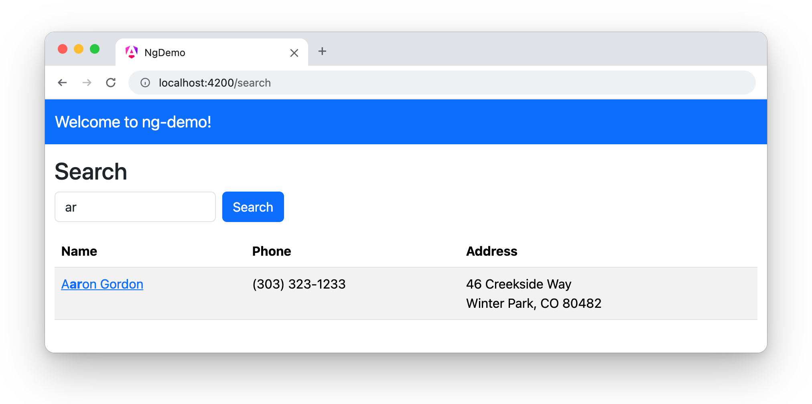
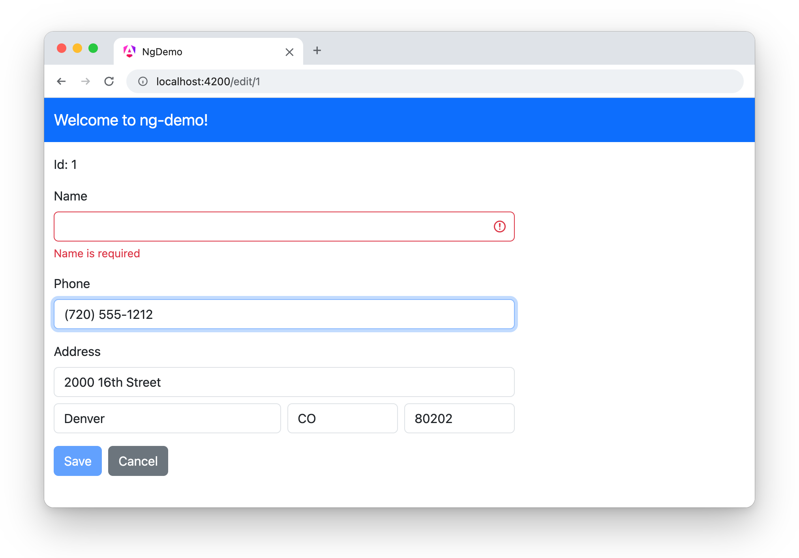

= Bootstrap with Angular 22
:author: Matt Raible
:email:  matt@raibledesigns.com
:revnumber: 22.0.0
:revdate: {docdate}
:icons: font
:lang: en
ifdef::env-github[]
:outfilesuffix: .adoc
:caution-caption: :fire:
:important-caption: :exclamation:
:note-caption: :paperclip:
:tip-caption: :bulb:
:warning-caption: :warning:
endif::[]
:toc:
:toclevels: 2
:source-highlighter: highlight.js

This tutorial shows you how to style the search and edit app from the link:README.adoc[Bare Bones Angular tutorial] with https://getbootstrap.com[Bootstrap]. You'll also use https://ng-bootstrap.github.io[NG Bootstrap], a library of Bootstrap widgets written for Angular, to highlight search matches.

.Source Code
****
The finished code is in the https://github.com/mraible/ng-demo/tree/bootstrap[`bootstrap` branch]. Each section below is one commit, and you can see all the changes in the https://github.com/mraible/ng-demo/compare/main...bootstrap[comparison with `main`].
****

== Prerequisites

You'll need the app from the link:README.adoc[Bare Bones Angular tutorial]. If you didn't build it, clone the `main` branch and install its dependencies.

[source,shell]
----
git clone https://github.com/mraible/ng-demo.git
cd ng-demo
npm install
----

== Add Bootstrap and NG Bootstrap

Run `ng add` to install NG Bootstrap, Bootstrap, Popper, and `@angular/localize` (which NG Bootstrap uses to translate its widgets).

[source,shell]
----
ng add @ng-bootstrap/ng-bootstrap
----

The schematic adds Bootstrap's CSS and the `@angular/localize` polyfill to `angular.json`.

[source,diff]
----
diff --git a/angular.json b/angular.json
--- a/angular.json
+++ b/angular.json
@@ -30,7 +30,11 @@
               }
             ],
             "styles": [
+              "node_modules/bootstrap/dist/css/bootstrap.min.css",
               "src/styles.css"
+            ],
+            "polyfills": [
+              "@angular/localize/init"
             ]
           },
           "configurations": {
@@ -38,7 +42,7 @@
               "budgets": [
                 {
                   "type": "initial",
-                  "maximumWarning": "500kB",
+                  "maximumWarning": "600kB",
                   "maximumError": "1MB"
                 },
                 {
----

It also adds a reference to `@angular/localize` types in `src/main.ts`, `tsconfig.app.json`, and `tsconfig.spec.json`.

The schematic adds `importProvidersFrom(NgbModule)` to `src/app/app.config.ts` too. You don't need it, because NG Bootstrap's components are standalone and you'll import the ones you use. Remove it, and your bundle will be about 35 kB smaller.

Even without it, Bootstrap's CSS makes your bundle bigger than the 500 kB budget, so `ng build` will warn you. That's why the diff above raises the warning threshold to 600 kB.

== Use a Bootstrap navbar

Replace the `<h1>` in `src/app/app.html` with a navbar, and wrap the router outlet in a container.

[source,html]
.src/app/app.html
----
<nav class="navbar bg-primary" data-bs-theme="dark">
  

    Welcome to {{ title() }}!
  

</nav>

  <router-outlet />

----

Update `src/app/app.spec.ts` to look for the title in the navbar.

[source,typescript]
.src/app/app.spec.ts
----
  it('should render title', async () => {
    const fixture = TestBed.createComponent(App);
    await fixture.whenStable();
    const compiled = fixture.nativeElement as HTMLElement;
    expect(compiled.querySelector('.navbar-brand')?.textContent).toContain('Welcome to ng-demo!');
  });
----

== Style search and highlight matches

Change `src/app/search/search.html` to use Bootstrap's form and table classes. Then, wrap each person's name in an `<ngb-highlight>` component, so the part of the name that matches your query is bold.

[source,html]
.src/app/search/search.html
----
<h2 class="mt-3">Search</h2>
<form class="row g-2">
  

    <input type="search" name="query" [(ngModel)]="query" (keyup.enter)="search()"
           placeholder="Search" class="form-control">
  

  

    <button type="button" (click)="search()" class="btn btn-primary">Search</button>
  

</form>
@if (searchResults().length) {
<table class="table table-striped mt-3">
  <thead>
  <tr>
    <th>Name</th>
    <th>Phone</th>
    <th>Address</th>
  </tr>
  </thead>
  <tbody>
  @for (person of searchResults(); track person.id) {
  <tr>
    <td><a [routerLink]="['/edit', person.id]"><ngb-highlight [result]="person.name" [term]="query" /></a></td>
    <td>{{person.phone}}</td>
    <td>{{person.address.street}} 
      {{person.address.city}}, {{person.address.state}} {{person.address.zip}}
    </td>
  </tr>
  }
  </tbody>
</table>
}
----

Import `NgbHighlight` in `src/app/search/search.ts`. You can also delete `search.css` and remove its `styleUrl`, since Bootstrap handles the styling now.

[source,typescript]
.src/app/search/search.ts
----
import { Component, inject, OnDestroy, OnInit, signal } from '@angular/core';
import { FormsModule } from '@angular/forms';
import { ActivatedRoute, RouterLink } from '@angular/router';
import { NgbHighlight } from '@ng-bootstrap/ng-bootstrap';
import { Subscription } from 'rxjs';
import { Person, SearchService } from '../shared';

@Component({
  imports: [FormsModule, RouterLink, NgbHighlight],
  selector: 'app-search',
  templateUrl: './search.html',
})
----

Run `ng serve`, search for "`ar`", and you'll see the match highlighted.

[[bootstrap-search]]
.Search with Bootstrap

== Style the edit form

Update `src/app/edit/edit.html` to use Bootstrap's form controls, its grid for the address, and its validation classes. The `[class.is-invalid]` binding adds Bootstrap's `is-invalid` class when the name is empty, which turns the field red and shows the `invalid-feedback` message.

[source,html]
.src/app/edit/edit.html
----
@if (person(); as person) {

  <h3 class="mt-3">{{person.name}}</h3>
  <form (ngSubmit)="save()" #editForm="ngForm">
    
Id: {{person.id}}

    

      <label for="name" class="form-label">Name</label>
      <input [(ngModel)]="person.name" name="name" id="name" required class="form-control" #name="ngModel"
             [class.is-invalid]="name.invalid && !name.pristine"/>
      
Name is required

    

    

      <label for="phone" class="form-label">Phone</label>
      <input [(ngModel)]="person.phone" name="phone" id="phone" class="form-control"/>
    

    <fieldset class="mb-3">
      <legend class="fs-6">Address</legend>
      <input [(ngModel)]="person.address.street" name="street" id="street" class="form-control mb-2"
             aria-label="Street">
      

        

          <input [(ngModel)]="person.address.city" name="city" id="city" class="form-control" aria-label="City">
        

        

          <input [(ngModel)]="person.address.state" name="state" id="state" class="form-control" aria-label="State">
        

        

          <input [(ngModel)]="person.address.zip" name="zip" id="zip" class="form-control" aria-label="Zip">
        

      

    </fieldset>
    <button type="submit" id="save" class="btn btn-primary me-2" [disabled]="!editForm.form.valid">Save</button>
    <button type="button" (click)="cancel()" id="cancel" class="btn btn-secondary">Cancel</button>
  </form>

}
----

Delete `edit.css` and remove its `styleUrl` from `src/app/edit/edit.ts`.

Now, the edit form looks like a Bootstrap form.

[[bootstrap-edit]]
.Edit form with Bootstrap

You didn't change any element IDs or the structure of the search results, so all your tests pass without changes. Run `ng test` and `npm run cy:run` to prove it.

== Learn more

To learn more, see https://getbootstrap.com/docs/5.3/getting-started/introduction/[Bootstrap's documentation] and https://ng-bootstrap.github.io/#/components[NG Bootstrap's components].

Go back to the link:README.adoc[Bare Bones Angular tutorial] to try the other bonus tutorials.
