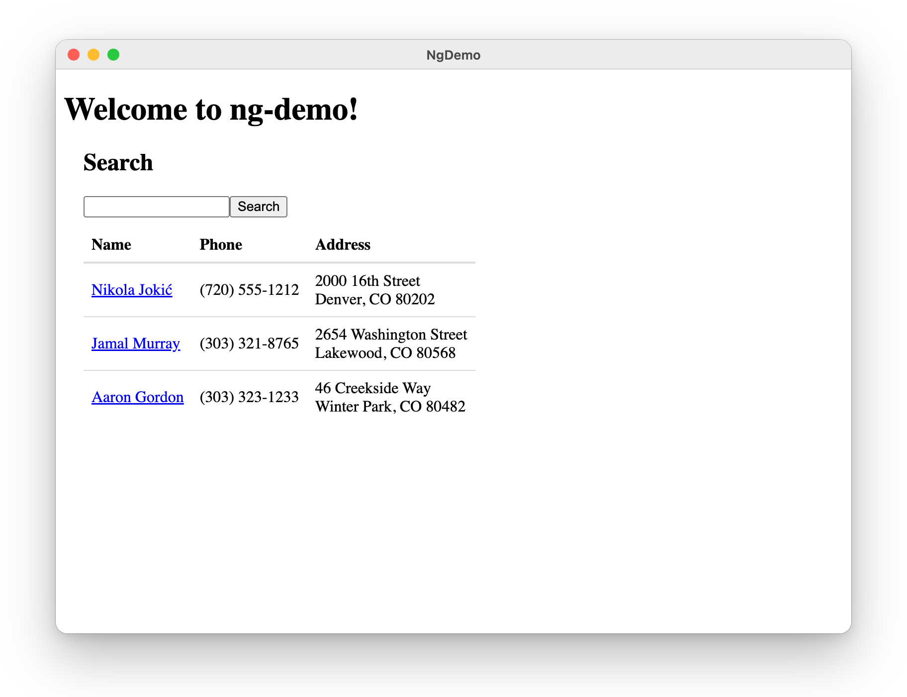

= Electron with Angular 22
:author: Matt Raible
:email:  matt@raibledesigns.com
:revnumber: 22.0.0
:revdate: {docdate}
:icons: font
:lang: en
ifdef::env-github[]
:outfilesuffix: .adoc
:caution-caption: :fire:
:important-caption: :exclamation:
:note-caption: :paperclip:
:tip-caption: :bulb:
:warning-caption: :warning:
endif::[]
:toc:
:toclevels: 2
:source-highlighter: highlight.js

This tutorial shows you how to turn the search and edit app from the link:README.adoc[Bare Bones Angular tutorial] into a desktop app with https://www.electronjs.org/[Electron]. Then, you'll package it for distribution with https://www.electron.build/[electron-builder].

.Source Code
****
The finished code is in the https://github.com/mraible/ng-demo/tree/electron[`electron` branch]. Each section below is one commit, and you can see all the changes in the https://github.com/mraible/ng-demo/compare/main...electron[comparison with `main`].
****

== Prerequisites

You'll need the app from the link:README.adoc[Bare Bones Angular tutorial]. If you didn't build it, clone the `main` branch and install its dependencies.

[source,shell]
----
git clone https://github.com/mraible/ng-demo.git
cd ng-demo
npm install
----

== Run your Angular app in Electron

Install Electron.

[source,shell]
----
npm install -D --save-exact electron@44.9.0
----

An Electron app has a _main process_, which runs in Node.js and creates windows, and _renderer processes_, which display web pages in those windows. Create a `main.js` file in your project's root directory for the main process.

[source,javascript]
.main.js
----
const { app, BrowserWindow, net, protocol, shell } = require('electron');
const fs = require('node:fs');
const path = require('node:path');
const { pathToFileURL } = require('node:url');

const appUrl = 'app://ng-demo/';
const browserDir = path.join(__dirname, 'dist/ng-demo/browser');

// Serve the Angular app from app://ng-demo/ so deep links and reloads work like they do on a web server
protocol.registerSchemesAsPrivileged([
  { scheme: 'app', privileges: { standard: true, secure: true, supportFetchAPI: true } }
]);

// Open links to other sites in the user's browser instead of in the app's window
function openExternally(url) {
  if (url.startsWith('https://')) shell.openExternal(url);
}

function createWindow() {
  const mainWindow = new BrowserWindow({
    width: 800,
    height: 600
  });

  mainWindow.webContents.on('will-navigate', (event, url) => {
    if (!url.startsWith(appUrl)) {
      event.preventDefault();
      openExternally(url);
    }
  });
  mainWindow.webContents.setWindowOpenHandler(({ url }) => {
    openExternally(url);
    return { action: 'deny' };
  });

  mainWindow.loadURL(appUrl);

  // Uncomment if you want to open Chrome DevTools by default
  // mainWindow.webContents.openDevTools();
}

app.whenReady().then(() => {
  protocol.handle('app', async (request) => {
    const pathname = decodeURIComponent(new URL(request.url).pathname);
    const file = path.join(browserDir, pathname);
    const isFile = file.startsWith(browserDir + path.sep) && fs.statSync(file, { throwIfNoEntry: false })?.isFile();
    // Return 404 for missing files like main-1234.js, and index.html for routes like /search;term=Nikola so
    // Angular's router can handle them
    if (!isFile && /\.[a-z0-9]+$/i.test(pathname) && !pathname.includes(';')) {
      return new Response('Not found', { status: 404 });
    }
    const response = await net.fetch(pathToFileURL(isFile ? file : path.join(browserDir, 'index.html')).toString());
    const headers = new Headers({ 'Content-Security-Policy': "default-src 'self'; style-src 'self' 'unsafe-inline'" });
    const contentType = response.headers.get('Content-Type');
    if (contentType) headers.set('Content-Type', contentType);
    return new Response(response.body, { headers });
  });

  createWindow();

  app.on('activate', () => {
    if (BrowserWindow.getAllWindows().length === 0) createWindow();
  });
});

app.on('window-all-closed', () => {
  if (process.platform !== 'darwin') app.quit();
});
----

This code serves your built Angular app from a custom `app://` protocol instead of loading `index.html` from the file system. If you use `mainWindow.loadFile()` instead, the app works until you reload the window (for example, with *View* > *Reload*). Then, Electron tries to load a file named `search` and fails with `ERR_FILE_NOT_FOUND`. The protocol handler returns `index.html` for paths like that, so Angular's router can handle them, just like a web server would. A path that looks like a file (such as `main-1234.js`) gets a 404 if the file doesn't exist, so a missing script fails clearly instead of loading `index.html`. The handler also adds a Content Security Policy, which keeps Electron from logging a security warning.

The `will-navigate` listener and `setWindowOpenHandler()` keep your app's window on `app://ng-demo/`. If a link points to another site, it opens in the user's browser instead of in a window that can load your app's protocol.

TIP: Electron's https://www.electronjs.org/docs/latest/tutorial/security[security checklist] recommends a custom protocol over `file://`. You don't need `nodeIntegration`, since your Angular app doesn't use Node.js APIs.

Set `main.js` as your app's entry point and add an `electron` script to `package.json` that builds your app and starts Electron.

[source,diff]
----
diff --git a/package.json b/package.json
--- a/package.json
+++ b/package.json
@@ -3,6 +3,7 @@
   "author": "Matt Raible <mraible@gmail.com>",
   "version": "22.0.0",
   "license": "MIT",
+  "main": "main.js",
   "scripts": {
     "ng": "ng",
     "start": "ng serve",
@@ -12,7 +13,8 @@
     "e2e": "ng e2e",
     "cypress:open": "cypress open",
     "cypress:run": "cypress run",
-    "cy:run": "concurrently -k -s first \"ng serve\" \"cypress run\""
+    "cy:run": "concurrently -k -s first \"ng serve\" \"cypress run\"",
+    "electron": "ng build && electron ."
   },
   "private": true,
   "packageManager": "npm@11.13.0",
@@ -34,6 +36,7 @@
     "@vitest/coverage-v8": "5.0.4",
     "concurrently": "10.0.6",
     "cypress": "16.2.0",
+    "electron": "44.9.0",
     "jsdom": "30.1.3",
     "prettier": "3.9.10",
     "typescript": "6.0.3",
----

Run `npm run electron`, and your app will open in a desktop window.

[[electron]]
.Angular in Electron

== Package your app for distribution

To package your app for macOS, Windows, or Linux, install electron-builder.

[source,shell]
----
npm install -D --save-exact electron-builder@26.15.3
----

Add a `build` section to `package.json` with your app's ID and name, and `pack` and `dist` scripts.

[source,diff]
----
diff --git a/package.json b/package.json
--- a/package.json
+++ b/package.json
@@ -4,6 +4,21 @@
   "version": "22.0.0",
   "license": "MIT",
   "main": "main.js",
+  "build": {
+    "appId": "bare.bones.angular",
+    "productName": "Bare Bones Angular",
+    "directories": {
+      "output": "release"
+    },
+    "mac": {
+      "category": "public.app-category.developer-tools"
+    },
+    "files": [
+      "main.js",
+      "dist/ng-demo/browser/**/*",
+      "!node_modules/**/*"
+    ]
+  },
   "scripts": {
     "ng": "ng",
     "start": "ng serve",
@@ -14,7 +29,9 @@
     "cypress:open": "cypress open",
     "cypress:run": "cypress run",
     "cy:run": "concurrently -k -s first \"ng serve\" \"cypress run\"",
-    "electron": "ng build && electron ."
+    "electron": "ng build && electron .",
+    "pack": "ng build && electron-builder --dir",
+    "dist": "ng build && electron-builder"
   },
   "private": true,
   "packageManager": "npm@11.13.0",
@@ -37,6 +54,7 @@
     "concurrently": "10.0.6",
     "cypress": "16.2.0",
     "electron": "44.9.0",
+    "electron-builder": "26.15.3",
     "jsdom": "30.1.3",
     "prettier": "3.9.10",
     "typescript": "6.0.3",
----

The `files` setting only packages `main.js` and your built Angular app. Your Angular dependencies are already bundled into the app's JavaScript, so there's no need to include `node_modules`. The `directories.output` setting puts packages in a `release` directory, so they don't mix with Angular's build output in `dist`. Add it to `.gitignore`.

[source,diff]
----
diff --git a/.gitignore b/.gitignore
--- a/.gitignore
+++ b/.gitignore
@@ -45,3 +45,6 @@ Thumbs.db
 
 # Local Netlify folder
 .netlify
+
+# Electron packages
+/release
----

To package your app:

* `npm run pack` creates an unpacked app in `release/mac-arm64` (or the folder for your platform), which is handy for testing.
* `npm run dist` creates a distributable format, like a `.dmg` on macOS, an installer on Windows, or an AppImage on Linux.

NOTE: If you don't have a code-signing certificate, electron-builder will try to find one and skip signing. To skip the search on macOS, run `export CSC_IDENTITY_AUTO_DISCOVERY=false` first. To distribute your app outside your own machine, see electron-builder's https://www.electron.build/code-signing[code signing] documentation.

== Learn more

To learn more, see https://www.electronjs.org/docs/latest/[Electron's documentation] and https://www.electron.build/[electron-builder's documentation].

Go back to the link:README.adoc[Bare Bones Angular tutorial] to try the other bonus tutorials.
