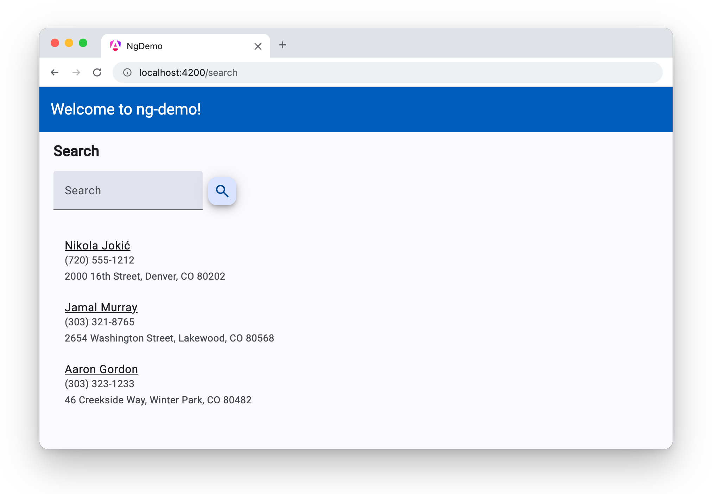
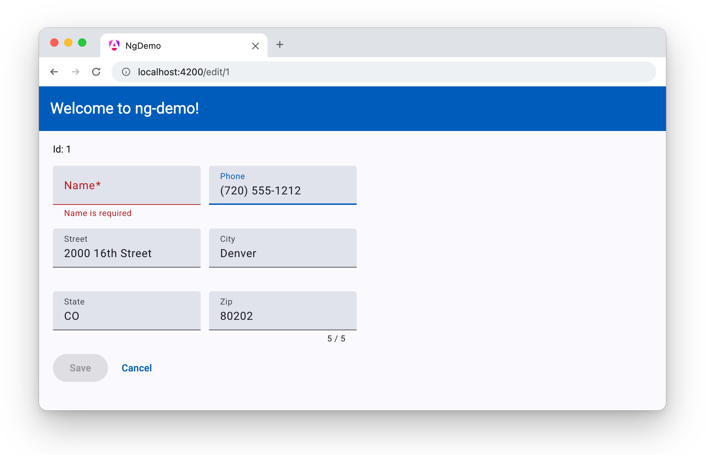

= Angular Material with Angular 22
:author: Matt Raible
:email:  matt@raibledesigns.com
:revnumber: 22.0.0
:revdate: {docdate}
:icons: font
:lang: en
ifdef::env-github[]
:outfilesuffix: .adoc
:caution-caption: :fire:
:important-caption: :exclamation:
:note-caption: :paperclip:
:tip-caption: :bulb:
:warning-caption: :warning:
endif::[]
:toc:
:toclevels: 2
:source-highlighter: highlight.js

This tutorial shows you how to make the search and edit app from the link:README.adoc[Bare Bones Angular tutorial] look like a Google app with https://material.angular.dev/[Angular Material]. You'll add a Material theme, then swap the app's plain HTML for a toolbar, form fields, buttons, icons, and a list.

.Source Code
****
The finished code is in the https://github.com/mraible/ng-demo/tree/angular-material[`angular-material` branch]. Each section below is one commit, and you can see all the changes in the https://github.com/mraible/ng-demo/compare/main...angular-material[comparison with `main`].
****

== Prerequisites

You'll need the app from the link:README.adoc[Bare Bones Angular tutorial]. If you didn't build it, clone the `main` branch and install its dependencies.

[source,shell]
----
git clone https://github.com/mraible/ng-demo.git
cd ng-demo
npm install
----

== Add Angular Material

Run `ng add` to install Angular Material and its Component Dev Kit (CDK).

[source,shell]
----
ng add @angular/material@22.2.3
----

When prompted, pick a color palette for your theme. This tutorial uses the default, Azure/Blue.

The schematic creates a `src/material-theme.scss` file that defines a Material 3 theme and sets the page's background, font, and text colors.

[source,scss]
.src/material-theme.scss
----
// Include theming for Angular Material with `mat.theme()`.
// This Sass mixin will define CSS variables that are used for styling Angular Material
// components according to the Material 3 design spec.
// Learn more about theming and how to use it for your application's
// custom components at https://material.angular.dev/guide/theming
@use '@angular/material' as mat;

html {
  height: 100%;
  @include mat.theme(
    (
      color: (
        primary: mat.$azure-palette,
        tertiary: mat.$blue-palette,
      ),
      typography: Roboto,
      density: 0,
    )
  );
}

body {
  // Default the application to a light color theme. This can be changed to
  // `dark` to enable the dark color theme, or to `light dark` to defer to the
  // user's system settings.
  color-scheme: light;

  // Set a default background, font and text colors for the application using
  // Angular Material's system-level CSS variables. Learn more about these
  // variables at https://material.angular.dev/guide/system-variables
  background-color: var(--mat-sys-surface);
  color: var(--mat-sys-on-surface);
  font: var(--mat-sys-body-medium);

  // Reset the user agent margin.
  margin: 0;
  height: 100%;
}
----

It also adds the theme to the `styles` in `angular.json`.

[source,diff]
----
diff --git a/angular.json b/angular.json
--- a/angular.json
+++ b/angular.json
@@ -30,6 +30,7 @@
               }
             ],
             "styles": [
+              "src/material-theme.scss",
               "src/styles.css"
             ]
           },
----

And it loads the Roboto font and Material Symbols icons in `src/index.html`.

[source,diff]
----
diff --git a/src/index.html b/src/index.html
--- a/src/index.html
+++ b/src/index.html
@@ -6,6 +6,10 @@
   <base href="/">
   <meta name="viewport" content="width=device-width, initial-scale=1">
   <link rel="icon" type="image/x-icon" href="favicon.ico">
+  <link rel="preconnect" href="https://fonts.googleapis.com">
+  <link rel="preconnect" href="https://fonts.gstatic.com" crossorigin>
+  <link href="https://fonts.googleapis.com/css2?family=Roboto:wght@300;400;500&display=swap" rel="stylesheet">
+  <link href="https://fonts.googleapis.com/icon?family=Material+Symbols+Outlined" rel="stylesheet">
 </head>
 <body>
   <app-root></app-root>
----

TIP: `ng add` might reformat `angular.json` and `src/index.html` with Prettier. The diffs above only show the lines that matter.

Since your theme loads fonts from Google, allow them in the content security policy (CSP) in `netlify.toml`.

[source,diff]
----
diff --git a/netlify.toml b/netlify.toml
--- a/netlify.toml
+++ b/netlify.toml
@@ -14,7 +14,7 @@
 [[headers]]
   for = "/*"
   [headers.values]
-    Content-Security-Policy = "default-src 'self'; script-src 'self'; style-src 'self' 'unsafe-inline'; img-src 'self' data:; font-src 'self' data:; frame-ancestors 'none'"
+    Content-Security-Policy = "default-src 'self'; script-src 'self'; style-src 'self' 'unsafe-inline' https://fonts.googleapis.com; img-src 'self' data:; font-src 'self' data: https://fonts.gstatic.com; frame-ancestors 'none'"
     Referrer-Policy = "strict-origin-when-cross-origin"
     X-Content-Type-Options = "nosniff"
     X-Frame-Options = "DENY"
----

== Use a Material toolbar

Replace the `<h1>` in `src/app/app.html` with a `<mat-toolbar>`.

[source,html]
.src/app/app.html
----
<mat-toolbar>Welcome to {{ title() }}!</mat-toolbar>

<router-outlet />
----

Import `MatToolbar` in `src/app/app.ts`. Angular Material's components are standalone, so you can import just the ones you use.

[source,typescript]
.src/app/app.ts
----
import { Component, signal } from '@angular/core';
import { RouterOutlet } from '@angular/router';
import { MatToolbar } from '@angular/material/toolbar';

@Component({
  imports: [RouterOutlet, MatToolbar],
  selector: 'app-root',
  styleUrl: './app.css',
  templateUrl: './app.html',
})
export class App {
  protected readonly title = signal('ng-demo');
}
----

Material 3 toolbars use the same color as the page, so give it your theme's primary color in `src/app/app.css`.

[source,css]
.src/app/app.css
----
mat-toolbar {
  background: var(--mat-sys-primary);
  color: var(--mat-sys-on-primary);
}
----

Then, update `src/app/app.spec.ts` to look for the title in the toolbar.

[source,typescript]
.src/app/app.spec.ts
----
  it('should render title', async () => {
    const fixture = TestBed.createComponent(App);
    await fixture.whenStable();
    const compiled = fixture.nativeElement as HTMLElement;
    expect(compiled.querySelector('mat-toolbar')?.textContent).toContain('Welcome to ng-demo!');
  });
----

== Make search look like Material

Change `src/app/search/search.html` to use a Material form field and an icon button for the search form, and a Material list for the results.

[source,html]
.src/app/search/search.html
----
<h2>Search</h2>
<form>
  <mat-form-field>
    <mat-label>Search</mat-label>
    <input matInput type="search" name="query" [(ngModel)]="query" (keyup.enter)="search()">
  </mat-form-field>
  <button matMiniFab type="button" (click)="search()" aria-label="Search">
    <mat-icon>search</mat-icon>
  </button>
</form>
@if (searchResults().length) {
<mat-list>
  @for (person of searchResults(); track person.id) {
  <mat-list-item lines="3">
    <a matListItemTitle [routerLink]="['/edit', person.id]">{{person.name}}</a>
    {{person.phone}}
    {{person.address.street}}, {{person.address.city}}, {{person.address.state}} {{person.address.zip}}
  </mat-list-item>
  }
</mat-list>
}
----

Import the components you used in `src/app/search/search.ts`.

[source,typescript]
.src/app/search/search.ts
----
import { Component, inject, OnDestroy, OnInit, signal } from '@angular/core';
import { FormsModule } from '@angular/forms';
import { ActivatedRoute, RouterLink } from '@angular/router';
import { MatFormField, MatLabel } from '@angular/material/form-field';
import { MatInput } from '@angular/material/input';
import { MatMiniFabButton } from '@angular/material/button';
import { MatIcon } from '@angular/material/icon';
import { MatList, MatListItem, MatListItemLine, MatListItemTitle } from '@angular/material/list';
import { Subscription } from 'rxjs';
import { Person, SearchService } from '../shared';

@Component({
  imports: [FormsModule, RouterLink, MatFormField, MatLabel, MatInput, MatMiniFabButton, MatIcon,
    MatList, MatListItem, MatListItemTitle, MatListItemLine],
  selector: 'app-search',
  styleUrl: './search.css',
  templateUrl: './search.html',
})
----

Replace the table styles in `src/app/search/search.css` with a rule that lines up the button with the search field.

[source,css]
.src/app/search/search.css
----
:host {
  display: block;
  padding: 0 20px;
}

form {
  display: flex;
  align-items: baseline;
  gap: 8px;
}
----

The search results aren't in a table anymore, so update the selectors in `cypress/e2e/search.cy.ts` and `cypress/e2e/edit.cy.ts` to look for `mat-list-item` elements.

[source,diff]
----
diff --git a/cypress/e2e/search.cy.ts b/cypress/e2e/search.cy.ts
--- a/cypress/e2e/search.cy.ts
+++ b/cypress/e2e/search.cy.ts
@@ -12,7 +12,7 @@ describe('Search', () => {
   it('should allow searching', () => {
     cy.get('input').type('A');
     cy.get('button').click();
-    const list = cy.get('app-search table tbody tr');
+    const list = cy.get('app-search mat-list-item');
     list.should('have.length', 3);
   });
 });
----

[source,diff]
----
diff --git a/cypress/e2e/edit.cy.ts b/cypress/e2e/edit.cy.ts
--- a/cypress/e2e/edit.cy.ts
+++ b/cypress/e2e/edit.cy.ts
@@ -15,7 +15,7 @@ describe('Edit', () => {
     cy.get('#name').type(' Rocks!');
     cy.get('#save').click();
     // verify one element matched this change
-    const list = cy.get('app-search table tbody tr');
+    const list = cy.get('app-search mat-list-item');
     list.should('have.length', 1);
   });
 });
----

Run `ng serve` and click the search button. You'll see the results in a Material list.

[[material-search]]
.Search with Angular Material

== Make the edit form look like Material

Update `src/app/edit/edit.html` to use Material form fields with labels, an error message for the required name, and Material buttons.

[source,html]
.src/app/edit/edit.html
----
@if (person(); as person) {
<h3>{{person.name}}</h3>
<form (ngSubmit)="save()" #editForm="ngForm">
  
Id: {{person.id}}

  

    <mat-form-field>
      <mat-label>Name</mat-label>
      <input matInput [(ngModel)]="person.name" name="name" id="name" required/>
      <mat-error>Name is required</mat-error>
    </mat-form-field>
    <mat-form-field>
      <mat-label>Phone</mat-label>
      <input matInput [(ngModel)]="person.phone" name="phone" id="phone"/>
    </mat-form-field>
  

  

    <mat-form-field>
      <mat-label>Street</mat-label>
      <input matInput [(ngModel)]="person.address.street" name="street" id="street">
    </mat-form-field>
    <mat-form-field>
      <mat-label>City</mat-label>
      <input matInput [(ngModel)]="person.address.city" name="city" id="city">
    </mat-form-field>
  

  

    <mat-form-field>
      <mat-label>State</mat-label>
      <input matInput [(ngModel)]="person.address.state" name="state" id="state" maxlength="2">
    </mat-form-field>
    <mat-form-field>
      <mat-label>Zip</mat-label>
      <input matInput #zip [(ngModel)]="person.address.zip" name="zip" id="zip" maxlength="5">
      <mat-hint align="end">{{zip.value.length}} / 5</mat-hint>
    </mat-form-field>
  

  <button matButton="filled" type="submit" id="save" [disabled]="!editForm.form.valid">Save</button>
  <button matButton type="button" (click)="cancel()" id="cancel">Cancel</button>
</form>
}
----

Import the form field, input, and button components in `src/app/edit/edit.ts`.

[source,typescript]
.src/app/edit/edit.ts
----
import { Component, inject, OnDestroy, OnInit, signal } from '@angular/core';
import { ActivatedRoute, Router } from '@angular/router';
import { FormsModule } from '@angular/forms';
import { MatError, MatFormField, MatHint, MatLabel } from '@angular/material/form-field';
import { MatInput } from '@angular/material/input';
import { MatButton } from '@angular/material/button';
import { Subscription } from 'rxjs';
import { Person, SearchService } from '../shared';

@Component({
  imports: [FormsModule, MatFormField, MatLabel, MatError, MatHint, MatInput, MatButton],
  selector: 'app-edit',
  styleUrl: './edit.css',
  templateUrl: './edit.html',
})
----

Add some spacing between the fields and buttons in `src/app/edit/edit.css`.

[source,css]
.src/app/edit/edit.css
----
:host {
  display: block;
  padding: 0 20px;
}

mat-form-field {
  margin-right: 12px;
}

button {
  margin-right: 8px;
}
----

Now, when you clear the name field, Material shows the error message under it and disables the *Save* button.

[[material-edit]]
.Edit form with Angular Material

With Angular Material's components and theme, your bundle is a bit larger than the 500 kB budget, so `ng build` will warn you. Raise the warning threshold in `angular.json`.

[source,diff]
----
diff --git a/angular.json b/angular.json
--- a/angular.json
+++ b/angular.json
@@ -39,7 +39,7 @@
               "budgets": [
                 {
                   "type": "initial",
-                  "maximumWarning": "500kB",
+                  "maximumWarning": "600kB",
                   "maximumError": "1MB"
                 },
                 {
----

Run `ng test` and `npm run cy:run` to make sure all your tests still pass.

== Learn more

To learn more about Angular Material, see its https://material.angular.dev/components/categories[components] and https://material.angular.dev/guide/theming[theming guide].

Go back to the link:README.adoc[Bare Bones Angular tutorial] to try the other bonus tutorials.
