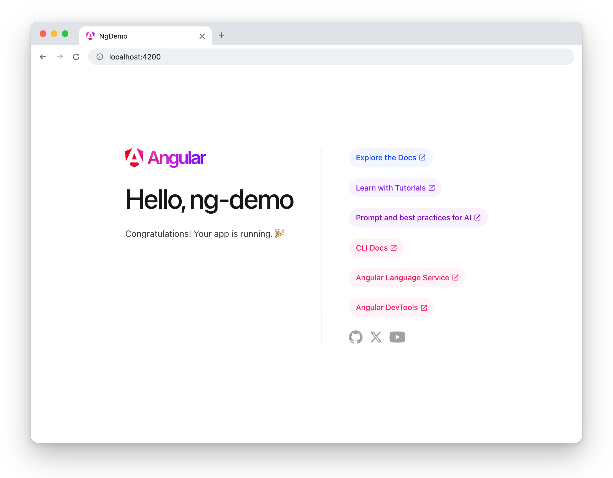
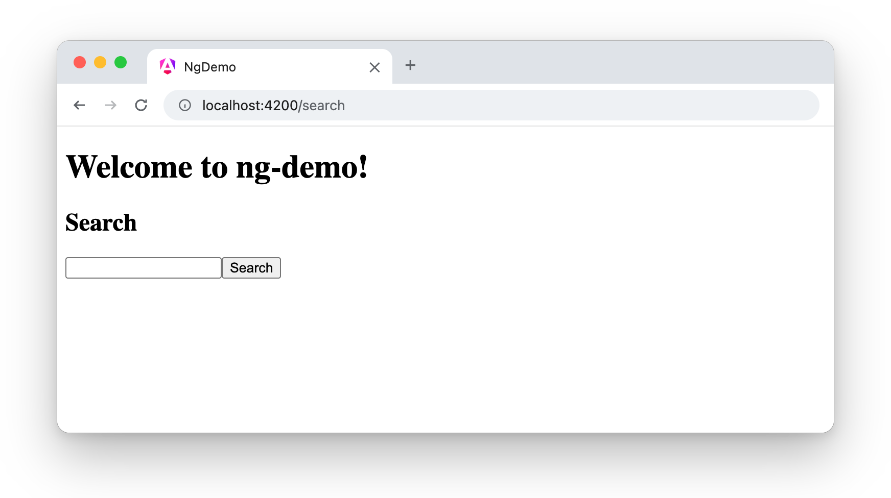
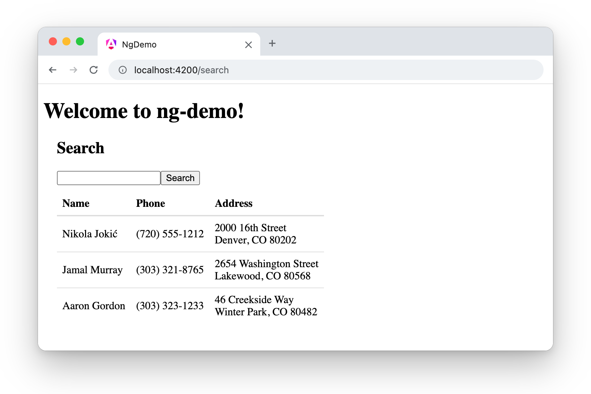
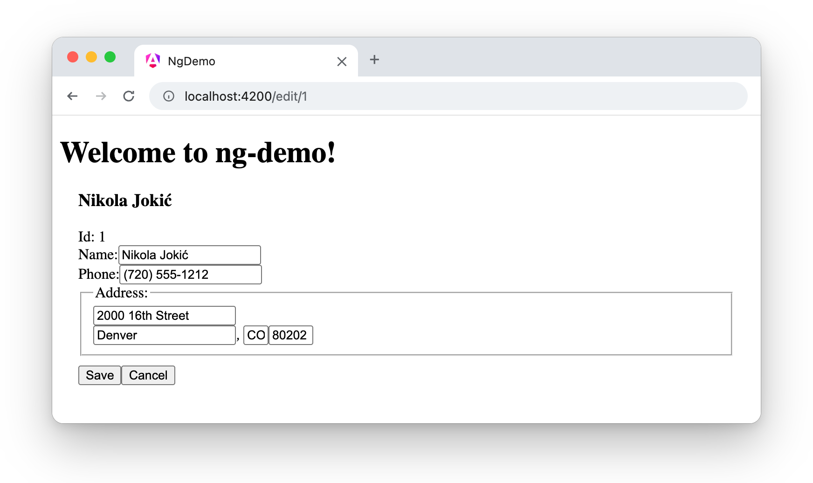
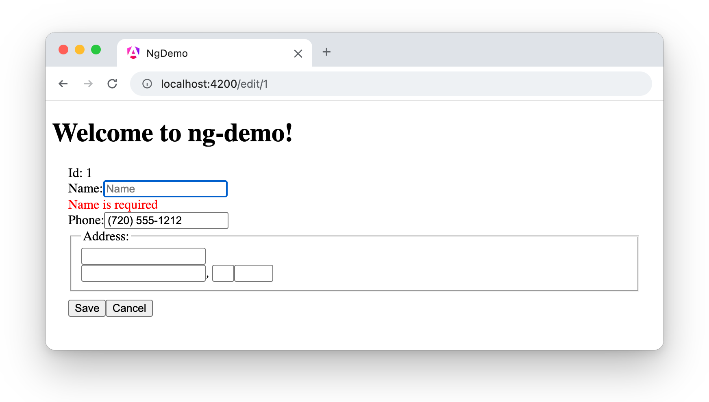
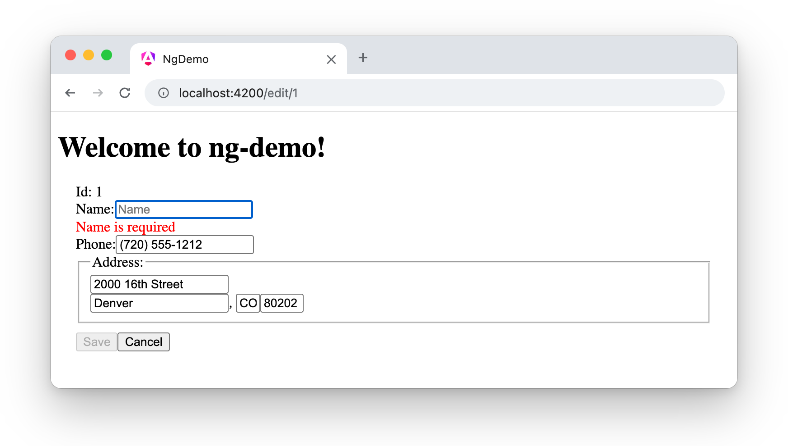
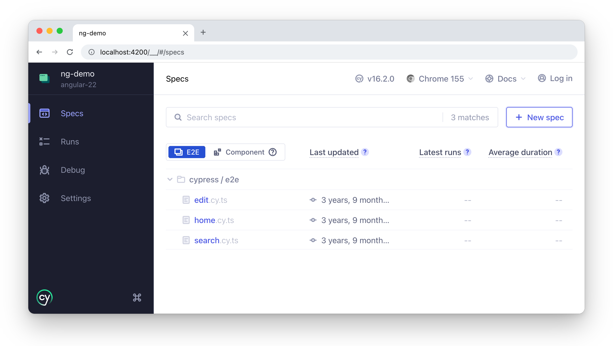
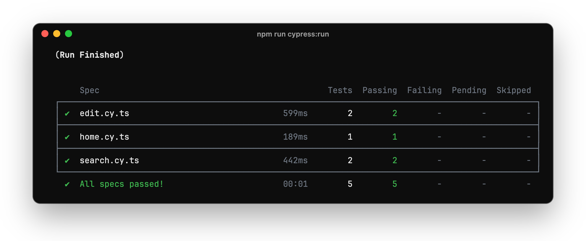
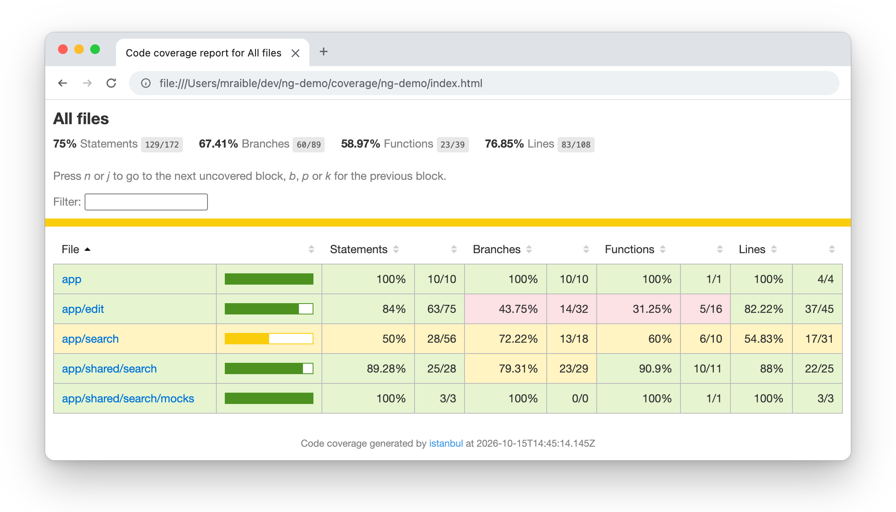
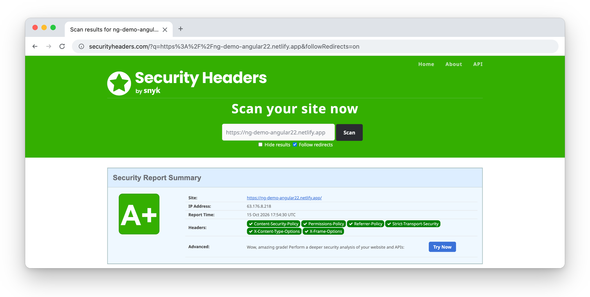

= &#x1F9B4; Bare Bones Angular and Angular CLI Tutorial

:author: Matt Raible
:email:  matt@raibledesigns.com
:revnumber: 22.0.0
:revdate: {docdate}
:subject: Angular and Angular CLI
:keywords: Angular, Angular CLI, TypeScript, JavaScript, Node, npm, Vitest, Cypress
:icons: font
:lang: en
:language: javadocript
:sourcedir: .
ifndef::env-github[]
:icons: font
endif::[]
ifdef::env-github,env-browser[]
:toc: preamble
:toclevels: 2
endif::[]
ifdef::env-github[]
:status:
:outfilesuffix: .adoc
:!toc-title:
:caution-caption: :fire:
:important-caption: :exclamation:
:note-caption: :paperclip:
:tip-caption: :bulb:
:warning-caption: :warning:
endif::[]
:toc: macro
:source-highlighter: highlight.js

IMPORTANT: For a book of this tutorial, please check out https://www.infoq.com/minibooks/angular-mini-book/[The Angular Mini-Book]. Its "Build an Angular App" chapter was inspired by this tutorial.

This tutorial shows you how to build a bare-bones search and edit application using https://angular.dev[Angular] and
https://github.com/angular/angular-cli[Angular CLI] version 22.

toc::[]

ifdef::env-github[]
TIP: It appears you're reading this document on GitHub. If you want a prettier view, install https://chrome.google.com/webstore/detail/asciidoctorjs-live-previe/iaalpfgpbocpdfblpnhhgllgbdbchmia[Asciidoctor.js Live Preview for Chrome], then view the https://raw.githubusercontent.com/mraible/ng-demo/main/README.adoc?toc=left[raw document]. Another option is to use the https://gist.asciidoctor.org/?github-mraible%2Fng-demo%2Fmain%2F%2FREADME.adoc[DocGist view].
endif::[]

.Source Code
****
If you'd like to get right to it, the https://github.com/mraible/ng-demo[source is on GitHub]. To run the app, use `ng serve`. To test it, run `ng test`. To run its integration tests, run `ng e2e`.
****

Check out the *bonus section* at the end of this document for Angular Material, Bootstrap, Auth0, and Electron tutorials.

toc::[]

== What you'll build

You'll build a simple web application with Angular CLI, a tool for Angular development. You'll create an application with search and edit features.

== What you'll need

* About 30 minutes.
* A favorite text editor or IDE. I recommend https://www.jetbrains.com/idea/[IntelliJ IDEA].
* http://nodejs.org/[Node.js] 22.22.3+, 24.15+, or 26+ and npm installed.
* https://github.com/angular/angular-cli[Angular CLI] installed.

If you don't have Angular CLI installed, install it:

----
npm install -g @angular/cli@22
----

NOTE: IntelliJ IDEA Ultimate Edition has the best support for TypeScript. If you'd rather not pay for your IDE, checkout https://code.visualstudio.com/[Visual Studio Code].

== Create a new Angular project

Create a new project using the `ng new` command:

----
ng new ng-demo
----

When prompted for the stylesheet system, choose "`CSS`" (the default). Accept the default (No) for SSR (Server-Side Rendering) and SSG (Static Site Generation). When asked which AI tools Angular should integrate with, select "`None`" (or the one you use).

This will create a `ng-demo` project and run `npm install` in it. It takes about a minute to complete, but will vary based on your internet connection speed.

If you've used previous versions of Angular, you'll notice a few differences in the generated project:

* Files no longer have a type suffix. The root component lives in `app.ts` and its class is named `App` (instead of `app.component.ts` and `AppComponent`).
* Applications are zoneless by default. There's no `zone.js` dependency and change detection is driven by signals and template events.
* Components use `OnPush` change detection by default.
* Unit tests run with https://vitest.dev/[Vitest] instead of Karma and Jasmine.
* Static files like images and JSON go in the `public` directory instead of `src/assets`.

You can see the version of Angular CLI you're using with the `ng version` command.

----
$ ng version

Angular CLI       : 22.2.2
Node.js           : 24.16.0
Package Manager   : npm 11.13.0
Operating System  : darwin arm64
----

If you run this command from the `ng-demo` directory, you'll see even more information.

----
Angular CLI       : 22.2.2
Angular           : 22.2.3
Node.js           : 24.16.0
Package Manager   : npm 11.13.0
Operating System  : darwin arm64

┌───────────────────────────┬───────────────────┬───────────────────┐
│ Package                   │ Installed Version │ Requested Version │
├───────────────────────────┼───────────────────┼───────────────────┤
│ @angular/build            │ 22.2.2            │ ^22.2.2           │
│ @angular/cli              │ 22.2.2            │ ^22.2.2           │
│ @angular/common           │ 22.2.3            │ ^22.2.0           │
│ @angular/compiler         │ 22.2.3            │ ^22.2.0           │
│ @angular/compiler-cli     │ 22.2.3            │ ^22.2.0           │
│ @angular/core             │ 22.2.3            │ ^22.2.0           │
│ @angular/forms            │ 22.2.3            │ ^22.2.0           │
│ @angular/platform-browser │ 22.2.3            │ ^22.2.0           │
│ @angular/router           │ 22.2.3            │ ^22.2.0           │
│ rxjs                      │ 7.8.2             │ ~7.8.0            │
│ typescript                │ 6.0.3             │ ~6.0.2            │
│ vitest                    │ 5.0.4             │ ^5.0.0            │
└───────────────────────────┴───────────────────┴───────────────────┘
----

== Run the application

The project is configured with a simple web server for development. To start it, run:

----
ng serve
----

You should see a screen like the one below at http://localhost:4200.

[[default-homepage]]
.Default homepage

You can make sure your new project's tests pass, run `ng test`:

----
$ ng test
...
 Test Files  1 passed (1)
      Tests  2 passed (2)
----

== Add a search feature

To add a search feature, open the project in an IDE or your favorite text editor.

=== The Basics

In a terminal window, cd into the `ng-demo` directory and run the following command to create a search component.

[source]
----
ng g component search
----

This creates `search.ts`, `search.html`, `search.css`, and `search.spec.ts` in `src/app/search`. Open `src/app/search/search.html` and replace its default HTML with the following:

[source,html]
.src/app/search/search.html
----
<h2>Search</h2>
<form>
  <input type="search" name="query" [(ngModel)]="query" (keyup.enter)="search()">
  <button type="button" (click)="search()">Search</button>
</form>
<pre>{{searchResults | json}}</pre>
----

Add a `query` property to `src/app/search/search.ts`. While you're there, add a `searchResults` property and an empty `search()` method.

[source,typescript]
.src/app/search/search.ts
----
export class Search {
  query: string | undefined;
  searchResults: any;

  search(): void { }
}
----

In `src/app/app.routes.ts`, modify the `routes` constant to add `Search` as the default:

[source,typescript]
.src/app/app.routes.ts
----
import { Routes } from '@angular/router';
import { Search } from './search/search';

export const routes: Routes = [
  { path: 'search', component: Search },
  { path: '', redirectTo: '/search', pathMatch: 'full' }
];
----

Run `ng serve` again you will see compilation errors.

----
✘ [ERROR] NG8002: Can't bind to 'ngModel' since it isn't a known property of 'input'.

✘ [ERROR] NG8004: No pipe found with name 'json'.
To fix this, import the "JsonPipe" class from "@angular/common" and add it to the "imports" array of the component.
----

To solve this, open `search.ts`. Import `FormsModule` and `JsonPipe`:

[source,typescript]
.src/app/search/search.ts
----
import { Component } from '@angular/core';
import { FormsModule } from '@angular/forms';
import { JsonPipe } from '@angular/common';

@Component({
  imports: [FormsModule, JsonPipe],
  selector: 'app-search',
  styleUrl: './search.css',
  templateUrl: './search.html',
})
----

Now you should be able to see the search form.

[[search-component]]
.Search component

If yours looks different, it's because I trimmed my `app.html` to the bare minimum.

[source,html]
.src/app/app.html
----
<h1>Welcome to {{ title() }}!</h1>

<router-outlet />
----

NOTE: The `title` property in `app.ts` is a https://angular.dev/guide/signals[signal], so you read its value by calling it: `title()`.

If you want to add styling for this component, open `src/app/search/search.css` and add some CSS. For example:

[source,css]
.src/app/search/search.css
----
:host {
  display: block;
  padding: 0 20px;
}
----

IMPORTANT: The `:host` allows you to target the container of the component. It's the only way to target the host element. You can't reach the host element from inside the component with other selectors because it's not part of the component's own template.

This section has shown you how to generate a new component and add it to a basic Angular application with Angular CLI. The next section shows you how to create and use a JSON file and `localStorage` to create a fake API.

=== The Backend

To get search results, create a `SearchService` that makes HTTP requests to a JSON file. Start by generating a new service.

----
ng g service shared/search/search-service
----

NOTE: If you run `ng g service shared/search/search`, Angular CLI will create a class named `Search`, the same name as your component. Adding `-service` gives you a `SearchService` class in `search-service.ts`.

Create `public/data/people.json` to hold your data. Files in `public` are served from the root of your app, so this file will be available at `data/people.json`.

----
mkdir -p public/data
----

[source,json]
.public/data/people.json
----
[
  {
    "id": 1,
    "name": "Nikola Jokić",
    "phone": "(720) 555-1212",
    "address": {
      "street": "2000 16th Street",
      "city": "Denver",
      "state": "CO",
      "zip": "80202"
    }
  },
  {
    "id": 2,
    "name": "Jamal Murray",
    "phone": "(303) 321-8765",
    "address": {
      "street": "2654 Washington Street",
      "city": "Lakewood",
      "state": "CO",
      "zip": "80568"
    }
  },
  {
    "id": 3,
    "name": "Aaron Gordon",
    "phone": "(303) 323-1233",
    "address": {
      "street": "46 Creekside Way",
      "city": "Winter Park",
      "state": "CO",
      "zip": "80482"
    }
  }
]
----

Modify `src/app/shared/search/search-service.ts` and inject `HttpClient` as a dependency.

In this same file, create a `getAll()` method to gather all the people. Also, define the `Address` and `Person` classes that JSON will be marshalled to.

[source,typescript]
.src/app/shared/search/search-service.ts
----
import { inject, Service } from '@angular/core';
import { HttpClient } from '@angular/common/http';
import { Observable } from 'rxjs';

@Service()
export class SearchService {
  private readonly http = inject(HttpClient);

  getAll(): Observable<Person[]> {
    return this.http.get<Person[]>('data/people.json');
  }
}

export class Address {
  street: string;
  city: string;
  state: string;
  zip: string;

  constructor(obj?: any) {
    this.street = obj?.street || null;
    this.city = obj?.city || null;
    this.state = obj?.state || null;
    this.zip = obj?.zip || null;
  }
}

export class Person {
  id: number;
  name: string;
  phone: string;
  address: Address;

  constructor(obj?: any) {
    this.id = obj?.id || null;
    this.name = obj?.name || null;
    this.phone = obj?.phone || null;
    this.address = obj?.address || null;
  }
}
----

The `@Service()` decorator is new in Angular 22. Like `@Injectable({providedIn: 'root'})`, it makes the service available everywhere in your app. Unlike `@Injectable`, it doesn't support constructor injection. If you try to inject `HttpClient` with `constructor(private http: HttpClient) {}`, you'll get an error:

----
✘ [ERROR] NG2028: @Service class cannot use constructor dependency injection. Use the `inject` function instead.
----

To make these classes easier to consume by your components, create `src/app/shared/index.ts` and add the following:

[source,typescript]
.src/app/shared/index.ts
----
export * from './search/search-service';
----

The reason for creating this file is so you can import multiple classes on a single line rather than having to import each individual class on separate lines.

In `search.ts`, add imports for these classes.

[source,typescript]
.src/app/search/search.ts
----
import { Person, SearchService } from '../shared';
----

You can now add a proper type to the `searchResults` variable. While you're there, inject the `SearchService`.

[source,typescript]
.src/app/search/search.ts
----
import { Component, inject } from '@angular/core';
...

export class Search {
  query: string | undefined;
  searchResults: Person[] = [];
  private readonly searchService = inject(SearchService);
----

Then update the `search()` method to call the service's `getAll()` method.

[source,typescript]
.src/app/search/search.ts
----
search(): void {
  this.searchService.getAll().subscribe({
    next: (data: Person[]) => {
      this.searchResults = data;
    },
    error: error => console.log(error)
  });
}
----

In previous versions of Angular, you'd need to add `provideHttpClient()` to `app.config.ts` at this point. In Angular 22, `HttpClient` is provided in the root injector, so it works without any configuration.

If you click the search button now, you'll notice that nothing happens. However, if you type something in the search box, the results appear!

This is because Angular 22 apps are zoneless and components use `OnPush` change detection. Angular no longer knows that something changed when an HTTP response arrives and you assign it to a regular property. It only updates the view after the next event, like a keystroke.

The fix is to use a https://angular.dev/guide/signals[signal]. Signals tell Angular exactly when their value changes. Change `searchResults` to a signal and call `set()` when the data arrives.

[source,typescript]
.src/app/search/search.ts
----
import { Component, inject, signal } from '@angular/core';
...

export class Search {
  query: string | undefined;
  searchResults = signal<Person[]>([]);
  private readonly searchService = inject(SearchService);

  search(): void {
    this.searchService.getAll().subscribe({
      next: (data: Person[]) => {
        this.searchResults.set(data);
      },
      error: error => console.log(error)
    });
  }
}
----

In `search.html`, read the signal's value by calling it.

[source,html]
.src/app/search/search.html
----
<pre>{{searchResults() | json}}</pre>
----

Now clicking the search button should work. To make the results look better, remove the `<pre>` tag and replace it with the following in `search.html`.

[source,html]
.src/app/search/search.html
----
@if (searchResults().length) {
<table>
  <thead>
  <tr>
    <th>Name</th>
    <th>Phone</th>
    <th>Address</th>
  </tr>
  </thead>
  <tbody>
  @for (person of searchResults(); track person.id) {
  <tr>
    <td>{{person.name}}</td>
    <td>{{person.phone}}</td>
    <td>{{person.address.street}} 
      {{person.address.city}}, {{person.address.state}} {{person.address.zip}}
    </td>
  </tr>
  }
  </tbody>
</table>
}
----

Since you're no longer using the `json` pipe, you'll see a warning:

----
▲ [WARNING] NG8113: JsonPipe is not used within the template of Search
----

Remove `JsonPipe` from the imports in `search.ts` to fix it.

[source,typescript]
.src/app/search/search.ts
----
@Component({
  imports: [FormsModule],
  ...
})
----

Then add some additional CSS to `search.css` to improve its table layout.

[source,css]
.src/app/search/search.css
----
table {
  margin-top: 10px;
  border-collapse: collapse;
}

th {
  text-align: left;
  border-bottom: 2px solid #ddd;
  padding: 8px;
}

td {
  border-top: 1px solid #ddd;
  padding: 8px;
}
----

Now the search results look better.

[[search-results]]
.Search results

But wait, you still don't have search functionality! To add a search feature, add a `search()` method to `SearchService`. It returns the people whose name, phone, or address contains the query.

[source,typescript]
.src/app/shared/search/search-service.ts
----
import { map, Observable } from 'rxjs';
...

  search(q: string): Observable<Person[]> {
    if (!q || q === '*') {
      q = '';
    } else {
      q = q.toLowerCase();
    }
    return this.getAll().pipe(
      map((data: Person[]) => data
        .filter((item: Person) => this.matches(item, q)))
    );
  }

  private matches(person: Person, q: string): boolean {
    const values = [person.name, person.phone, ...Object.values(person.address ?? {})];
    return values.some(value => value?.toLowerCase().includes(q));
  }
----

Then refactor `Search` to call this method with its `query` variable.

[source,typescript]
.src/app/search/search.ts
----
search(): void {
  this.searchService.search(this.query).subscribe({
    next: (data: Person[]) => {
      this.searchResults.set(data);
    },
    error: error => console.log(error)
  });
}
----

This won't compile right away.

[source,shell]
----
✘ [ERROR] TS2345: Argument of type 'string | undefined' is not assignable to parameter of type 'string'.
  Type 'undefined' is not assignable to type 'string'. [plugin angular-compiler]
----

Since `query` will always be assigned (even if it's empty), change its variable declaration to:

[source,typescript]
----
query!: string; // query: string = ''; will also work
----

This is called a https://www.typescriptlang.org/docs/handbook/release-notes/typescript-2-7.html#definite-assignment-assertions[definite assignment assertion]. It's a way to tell TypeScript "`I know what I'm doing, the variable will be assigned.`"

TIP: You don't need to make `query` a signal because it only changes when you type in the input. Template events like typing and clicking still trigger change detection.

Now search results will be filtered by the query value you type in.

This section showed you how to fetch and display search results. The next section builds on this and shows how to edit and save a record.

== Add an edit feature

Modify `search.html` to wrap the person's name with a link.

[source,html]
.src/app/search/search.html
----
<td><a [routerLink]="['/edit', person.id]">{{person.name}}</a></td>
----

Add `RouterLink` as an import to `search.ts` so everything will compile:

[source,typescript]
.src/app/search/search.ts
----
import { RouterLink } from '@angular/router';

@Component({
  imports: [FormsModule, RouterLink],
  ...
})
----

Run the following command to generate an `Edit` component.

[source]
----
ng g component edit
----

Add a route for this component in `app.routes.ts`:

[source,typescript]
.src/app/app.routes.ts
----
import { Edit } from './edit/edit';

export const routes: Routes = [
  { path: 'search', component: Search },
  { path: 'edit/:id', component: Edit },
  { path: '', redirectTo: '/search', pathMatch: 'full' }
];
----

Update `src/app/edit/edit.html` to display an editable form. You might notice I've added `id` attributes to most elements. This is to make it easier to locate elements when writing integration tests.

[source,html]
.src/app/edit/edit.html
----
@if (person(); as person) {
<h3>{{person.name}}</h3>
  

    <label>Id:</label>
    {{person.id}}
  

  

    <label>Name:</label>
    <input [(ngModel)]="person.name" name="name" id="name" placeholder="Name"/>
  

  

    <label>Phone:</label>
    <input [(ngModel)]="person.phone" name="phone" id="phone" placeholder="Phone"/>
  

  <fieldset>
    <legend>Address:</legend>
    <address>
      <input [(ngModel)]="person.address.street" id="street"> 
      <input [(ngModel)]="person.address.city" id="city">,
      <input [(ngModel)]="person.address.state" id="state" size="2">
      <input [(ngModel)]="person.address.zip" id="zip" size="5">
    </address>
  </fieldset>
  <button (click)="save()" id="save">Save</button>
  <button (click)="cancel()" id="cancel">Cancel</button>
}
----

Modify `Edit` to import model and service classes and to use the `SearchService` to get data. Like `searchResults`, the `person` is a signal so the form renders as soon as the data arrives.

[source,typescript]
.src/app/edit/edit.ts
----
import { Component, inject, OnDestroy, OnInit, signal } from '@angular/core';
import { ActivatedRoute, Router } from '@angular/router';
import { FormsModule } from '@angular/forms';
import { Subscription } from 'rxjs';
import { Person, SearchService } from '../shared';

@Component({
  imports: [FormsModule],
  selector: 'app-edit',
  styleUrl: './edit.css',
  templateUrl: './edit.html',
})
export class Edit implements OnInit, OnDestroy {
  person = signal<Person | undefined>(undefined);
  sub!: Subscription;
  private readonly route = inject(ActivatedRoute);
  private readonly router = inject(Router);
  private readonly service = inject(SearchService);

  ngOnInit(): void {
    this.sub = this.route.params.subscribe(params => {
      const id = +params['id']; // (+) converts string 'id' to a number
      this.service.get(id).subscribe(person => {
        if (person) {
          this.person.set(person);
        } else {
          this.gotoList();
        }
      });
    });
  }

  ngOnDestroy(): void {
    if (this.sub) {
      this.sub.unsubscribe();
    }
  }

  async cancel() {
    await this.router.navigate(['/search']);
  }

  async save() {
    this.service.save(this.person()!);
    await this.gotoList();
  }

  async gotoList() {
    const person = this.person();
    if (person) {
      await this.router.navigate(['/search', {term: person.name}]);
    } else {
      await this.router.navigate(['/search']);
    }
  }
}
----

Modify `SearchService` to contain functions for finding a person by their id and saving them. While you're in there, modify the `search()` method to be aware of updated objects in `localStorage`.

[source,typescript]
.src/app/shared/search/search-service.ts
----
search(q: string): Observable<Person[]> {
  if (!q || q === '*') {
    q = '';
  } else {
    q = q.toLowerCase();
  }
  return this.getAll().pipe(
    map((data: Person[]) => data
      .map((item: Person) => !!localStorage['person' + item.id] ?
        JSON.parse(localStorage['person' + item.id]) : item)
      .filter((item: Person) => this.matches(item, q))
    ));
}

get(id: number): Observable<Person> {
  return this.getAll().pipe(map((all: Person[]) => {
    if (localStorage['person' + id]) {
      return JSON.parse(localStorage['person' + id]);
    }
    return all.find((e: Person) => e.id === id);
  }));
}

save(person: Person) {
  localStorage['person' + person.id] = JSON.stringify(person);
}
----

You can add CSS to `src/app/edit/edit.css` if you want to make the form look a bit better.

[source,css]
.src/app/edit/edit.css
----
:host {
  display: block;
  padding: 0 20px;
}

button {
  margin-top: 10px;
}
----

At this point, you should be able to search for a person and update their information.

[[edit-form]]
.Edit component

The &lt;form> in `src/app/edit/edit.html` calls a `save()` function to update a person's data. You already implemented this above.
The function calls a `gotoList()` function that appends the person's name to the URL when sending the user back to the search screen.

[source,typescript]
.src/app/edit/edit.ts
----
async gotoList() {
  const person = this.person();
  if (person) {
    await this.router.navigate(['/search', {term: person.name}]);
  } else {
    await this.router.navigate(['/search']);
  }
}
----

Since the `Search` component doesn't execute a search automatically when you execute this URL, add the following logic to do so in its `ngOnInit()` method.

[source,typescript]
.src/app/search/search.ts
----
import { Component, inject, OnInit, signal } from '@angular/core';
import { ActivatedRoute, RouterLink } from '@angular/router';
import { Subscription } from 'rxjs';
...

export class Search implements OnInit {
  query!: string;
  searchResults = signal<Person[]>([]);
  sub!: Subscription;
  private readonly searchService = inject(SearchService);
  private readonly route = inject(ActivatedRoute);

  ngOnInit(): void {
    this.sub = this.route.params.subscribe(params => {
      if (params['term']) {
        this.query = params['term'];
        this.search();
      }
    });
  }
----

You'll want to implement `OnDestroy` and define the `ngOnDestroy` method to clean up this subscription.

[source,typescript]
.src/app/search/search.ts
----
import { Component, inject, OnDestroy, OnInit, signal } from '@angular/core';

export class Search implements OnInit, OnDestroy {
  ...

  ngOnDestroy(): void {
    if (this.sub) {
      this.sub.unsubscribe();
    }
  }
}
----

After making all these changes, you should be able to search/edit/update a person's information. If it works - nice job!

=== Form Validation

One thing you might notice is you can clear any input element in the form and save it. At the very least, the `name` field should be required. Otherwise, there's nothing to click on in the search results.

To make name required, modify `edit.html` to add a `required` attribute to the name `<input>` and bind it to Angular's validation with `#name="ngModel"`. Add a `
` next to the field to display an error message when validation fails.

[source,html]
.src/app/edit/edit.html
----
<input [(ngModel)]="person.name" name="name" id="name" placeholder="Name" required #name="ngModel"/>

  Name is required

----

You'll also need to wrap everything in a `<form>` element. Add `<form>` after the `<h3>` tag and close it before the closing `}`. You'll also need to add an `(ngSubmit)` handler to the form, give it the name of `editForm`, and change the save button to be a regular submit button that's disabled when the form is invalid. Give the cancel button `type="button"`, too. Buttons in a form default to `type="submit"`, so without it, clicking *Cancel* would submit the form and save your changes.

[source,html]
.src/app/edit/edit.html
----
<h3>{{person.name}}</h3>
<form (ngSubmit)="save()" #editForm="ngForm">
  ...
  <button type="submit" id="save" [disabled]="!editForm.form.valid">Save</button>
  <button type="button" (click)="cancel()" id="cancel">Cancel</button>
</form>
----

After making these changes, the name field will be required.

[[edit-form-required]]
.Edit form with validation

In this screenshot, you might notice the address fields are blank and the save button is enabled. This is explained by the error in your console.

----
ERROR RuntimeError: NG01352: If ngModel is used within a form tag, either the name attribute must be set or the form
    control must be defined as 'standalone' in ngModelOptions.

    Example 1: <input [(ngModel)]="person.firstName" name="first">
    Example 2: <input [(ngModel)]="person.firstName" [ngModelOptions]="{standalone: true}">
----

To fix this, add a `name` attribute to all the address fields. For example:

[source,html]
.src/app/edit/edit.html
----
<address>
  <input [(ngModel)]="person.address.street" name="street" id="street"> 
  <input [(ngModel)]="person.address.city" name="city" id="city">,
  <input [(ngModel)]="person.address.state" name="state" id="state" size="2">
  <input [(ngModel)]="person.address.zip" name="zip" id="zip" size="5">
</address>
----

Now values display in all fields, `name` is required, and save is disabled when the form is invalid.

[[edit-form-names]]
.Edit form with names and validation

To learn more about forms and validation, see https://angular.dev/guide/forms/form-validation[Angular's Validating form input documentation].

== Unit and End-to-End Testing

Now that you've built an application, it's important to test it to ensure it works. The best reason for writing tests is to automate your testing. Without tests, you'll likely be testing manually. This manual testing will take longer and longer as your application grows.

In this section, you'll learn to use https://vitest.dev/[Vitest] for unit testing components and services and https://www.cypress.io/[Cypress] for integration testing.

=== Fix the Tests

If you run `ng test`, you'll likely get failures for the components you created. These failures will be solved as you complete the section below. The `ng test` command will start a process that listens for changes so all you need to do is edit/save files and tests will be automatically run again.

----
NG0201: No provider found for `ActivatedRoute`. Source: Standalone[_Edit].
NG0201: No provider found for `ActivatedRoute`. Source: Standalone[_Search].
----

TIP: You can use `.skip` and `.only` on `describe` and `it` functions (for example, `it.only(...)`) to _exclude_ or _only_ run a particular test.

=== Fix the `App` test

If you changed the `app.html` template as I did, you'll need to modify `app.spec.ts` to account for the change in HTML. Change its last test to look for an `<h1>` element and the welcome message inside it.

[source,ts]
.src/app/app.spec.ts
----
it('should render title', async () => {
  const fixture = TestBed.createComponent(App);
  await fixture.whenStable();
  const compiled = fixture.nativeElement as HTMLElement;
  expect(compiled.querySelector('h1')?.textContent).toContain('Welcome to ng-demo!');
});
----

Now this test should pass.

[NOTE]
====
You might notice that `ng test` doesn't fail on this test _before_ you change it, even though the `<h1>` no longer says "Hello, ng-demo". With Angular CLI 22.2.2 and Vitest 5, compiled test files are cached in `node_modules/.vitest-cache`, and that cache isn't invalidated when only a component's HTML template changes. This is https://github.com/angular/angular-cli/pull/34311[fixed in Angular CLI] and the fix will be in its next patch release. Until then, if a test passes when you expect it to fail, delete the cache and run your tests again.

----
rm -rf node_modules/.vitest-cache
----
====

=== Unit test the SearchService

Modify `src/app/shared/search/search-service.spec.ts` and set up the test's infrastructure (a.k.a. `TestBed`) using `provideHttpClientTesting()` and `HttpTestingController`.

[source,typescript]
.src/app/shared/search/search-service.spec.ts
----
import { TestBed } from '@angular/core/testing';
import { HttpTestingController, provideHttpClientTesting } from '@angular/common/http/testing';
import { SearchService } from './search-service';

describe('SearchService', () => {
  let service: SearchService;
  let httpMock: HttpTestingController;

  beforeEach(() => {
    TestBed.configureTestingModule({
      providers: [provideHttpClientTesting()]
    });
    service = TestBed.inject(SearchService);
    httpMock = TestBed.inject(HttpTestingController);
  });

  it('should be created', () => {
    expect(service).toBeTruthy();
  });
});
----

`HttpTestingController` allows you to mock requests and use its `flush()` method to provide response values. Since the HTTP request methods return an `Observable`, you can subscribe to it and create expectations in the callback methods. Add the first test of `getAll()` to `search-service.spec.ts`.

The test below should be on the same level as `beforeEach`.

[source,typescript]
.src/app/shared/search/search-service.spec.ts
----
it('should retrieve all search results', () => {
  const mockResponse = [
    {name: 'Nikola Jokić'},
    {name: 'David Adelman'}
  ];

  service.getAll().subscribe((people: any) => {
    expect(people.length).toBe(2);
    expect(people[0].name).toBe('Nikola Jokić');
    expect(people).toEqual(mockResponse);
  });

  const req = httpMock.expectOne('data/people.json');
  expect(req.request.method).toBe('GET');
  req.flush(mockResponse);
});
----

While you're there, add an `afterEach()` to verify requests.

[source,typescript]
.src/app/shared/search/search-service.spec.ts
----
afterEach(() => {
  httpMock.verify();
});
----

Add a couple more tests for filtering by search term and fetching by id.

[source,typescript]
.src/app/shared/search/search-service.spec.ts
----
it('should filter by search term', () => {
  const mockResponse = [{name: 'Nikola Jokić'}];

  service.search('nik').subscribe((people: any) => {
    expect(people.length).toBe(1);
    expect(people[0].name).toBe('Nikola Jokić');
  });

  const req = httpMock.expectOne('data/people.json');
  expect(req.request.method).toBe('GET');
  req.flush(mockResponse);
});

it('should fetch by id', () => {
  const mockResponse = [
    {id: 1, name: 'Nikola Jokić'},
    {id: 2, name: 'David Adelman'}
  ];

  service.get(2).subscribe((person: any) => {
    expect(person.name).toBe('David Adelman');
  });

  const req = httpMock.expectOne('data/people.json');
  expect(req.request.method).toBe('GET');
  req.flush(mockResponse);
});
----

=== Unit test the Search component

To unit test the `Search` component, you can mock the methods in `SearchService` with https://vitest.dev/guide/mocking[mock functions]. These allow you to _spy_ on functions to check if they were called.

Create `src/app/shared/search/mocks/routes.ts` to mock Angular's `ActivatedRoute`.

[source,typescript]
.src/app/shared/search/mocks/routes.ts
----
import { ActivatedRoute } from '@angular/router';
import { of } from 'rxjs';

export class MockActivatedRoute extends ActivatedRoute {

  constructor(parameters?: { [key: string]: any; }) {
    super();
    // @ts-ignore
    this.params = of(parameters);
  }
}
----

WARNING: Don't use Vitest's `vi` global in this file. Angular 22 compiles every `.ts` file in `src` (except `*.spec.ts` files) when you run `ng serve` or `ng build`, so you'll get a `TS2304: Cannot find name 'vi'` error.

With this mock in place, you can use `TestBed.configureTestingModule()` to set up the `Search` component to use it as a provider. In the `beforeEach()`, you can see that the `search()` method is mocked with `vi.fn()` and its results are stubbed. The response isn't important in this case because you're just unit testing the `Search` component.

[source,typescript]
.src/app/search/search.spec.ts
----
import { ComponentFixture, TestBed } from '@angular/core/testing';
import { ActivatedRoute, provideRouter } from '@angular/router';
import { of } from 'rxjs';
import { Search } from './search';
import { SearchService } from '../shared';
import { MockActivatedRoute } from '../shared/search/mocks/routes';

describe('Search', () => {
  let component: Search;
  let fixture: ComponentFixture<Search>;
  let mockSearchService: SearchService;
  let mockActivatedRoute: MockActivatedRoute;

  beforeEach(async () => {
    mockActivatedRoute = new MockActivatedRoute({term: 'nikola'});

    await TestBed.configureTestingModule({
      imports: [Search],
      providers: [
        provideRouter([]),
        {provide: ActivatedRoute, useValue: mockActivatedRoute}
      ]
    }).compileComponents();

    // mock response
    mockSearchService = TestBed.inject(SearchService);
    mockSearchService.search = vi.fn().mockReturnValue(of([]));

    // initialize component
    fixture = TestBed.createComponent(Search);
    component = fixture.componentInstance;
    await fixture.whenStable();
  });

  it('should create', () => {
    expect(component).toBeTruthy();
  });
});
----

Add two tests, one to verify a search term is used when it's set on the component, and a second to verify search is called when a term is passed in as a route parameter.

[source,typescript]
.src/app/search/search.spec.ts
----
it('should search when a term is set and search() is called', () => {
  component.query = 'J';
  component.search();
  expect(mockSearchService.search).toHaveBeenCalledWith('J');
});

it('should search automatically when a term is on the URL', () => {
  expect(mockSearchService.search).toHaveBeenCalledWith('nikola');
});
----

Update the test for `Edit`, verifying fetching a single record works. Notice how you can access the component directly with `fixture.componentInstance`, or its rendered version with `fixture.nativeElement`.

[source,typescript]
.src/app/edit/edit.spec.ts
----
import { TestBed } from '@angular/core/testing';
import { ActivatedRoute, provideRouter } from '@angular/router';
import { of } from 'rxjs';
import { Edit } from './edit';
import { Address, Person, SearchService } from '../shared';
import { MockActivatedRoute } from '../shared/search/mocks/routes';

describe('Edit', () => {
  let mockSearchService: SearchService;
  let mockActivatedRoute: MockActivatedRoute;

  beforeEach(async () => {
    mockActivatedRoute = new MockActivatedRoute({id: 1});

    await TestBed.configureTestingModule({
      imports: [Edit],
      providers: [
        provideRouter([]),
        {provide: ActivatedRoute, useValue: mockActivatedRoute}
      ]
    }).compileComponents();

    mockSearchService = TestBed.inject(SearchService);
  });

  it('should fetch a single record', async () => {
    const fixture = TestBed.createComponent(Edit);

    const person = new Person({id: 1, name: 'Michael Porter Jr.'});
    person.address = new Address({city: 'Denver'});

    // mock response
    vi.spyOn(mockSearchService, 'get').mockReturnValue(of(person));

    // initialize component
    await fixture.whenStable();

    // verify service was called
    expect(mockSearchService.get).toHaveBeenCalledWith(1);

    // verify data was set on component when initialized
    const editComponent = fixture.componentInstance;
    expect(editComponent.person()?.address.city).toBe('Denver');

    // verify HTML renders as expected
    const compiled = fixture.nativeElement;
    expect(compiled.querySelector('h3').innerHTML).toBe('Michael Porter Jr.');
  });
});
----

You should see "`Tests  10 passed (10)`" in the shell window that's running `ng test`. If you don't, try canceling the command and restarting.

----
 Test Files  4 passed (4)
      Tests  10 passed (10)
----

=== Integration test the search UI

To test if the application works end-to-end, you can write tests with http://www.cypress.io/[Cypress]. These are also known as integration tests since they test the _integration_ between all layers of your application.

You can use the official https://www.npmjs.com/package/@cypress/schematic[Cypress Angular Schematic] to add Cypress to your Angular project.

----
ng add @cypress/schematic
----

When prompted to proceed and use Cypress for `ng e2e`, answer "`Yes`". When asked if you'd like to add Cypress component testing, answer "`No`". This tutorial doesn't use component testing, and the schematic configures it with webpack, which Angular 22 projects don't include.

This will add Cypress as a dependency and create configuration files to work with Angular and TypeScript. The generated `cypress.config.ts` is empty when you decline component testing, so update it to add an `e2e` section with your app's URL. While you're there, configure Cypress to use Chrome. Cypress 16 deprecates its bundled Electron browser and will remove it in a future version.

[source,typescript]
.cypress.config.ts
----
import { defineConfig } from 'cypress'

export default defineConfig({
  defaultBrowser: 'chrome',
  e2e: {
    baseUrl: 'http://localhost:4200'
  }
})
----

If you skip this step, `npm run cypress:run` will fail with "`The testing type selected (e2e) is not configured in your config file.`"

The schematic also adds itself as the first schematic collection in `angular.json`. Since it has its own `component` schematic that only works with NgModules, `ng g component` will fail with "`Could not find an NgModule`" after you add Cypress (see https://github.com/cypress-io/cypress/issues/28470[cypress#28470]). Move `@schematics/angular` to the top of the list to fix it.

[source,json]
.angular.json
----
"cli": {
  ...
  "schematicCollections": [
    "@schematics/angular",
    "@cypress/schematic"
  ]
},
----

Rename `cypress/e2e/spec.cy.ts` to `home.cy.ts` and change it to look for the title of your app.

[source,typescript]
.cypress/e2e/home.cy.ts
----
describe('Home', () => {
  it('Visits the initial project page', () => {
    cy.visit('/')
    cy.contains('Welcome to ng-demo!')
    cy.contains('Search')
  })
})
----

Then, run `ng e2e`. This will compile your app, start it on `http://localhost:4200`, and launch Cypress in Chrome.

.Cypress in Chrome

If you click on the file name, it'll run the test. You can use this feature to step through your tests, find selectors for elements, and much more. You can learn more about Cypress' features in its https://docs.cypress.io/app/core-concepts/open-mode[Open Mode documentation].

Personally, I prefer the Protractor experience where you could just run the command, it'd run all the tests, and the user doesn't need to interact. You can do this with Cypress too!

The Cypress Angular Schematic added a few scripts to your `package.json`:

[source,json]
----
"scripts": {
  ...
  "e2e": "ng e2e",
  "cypress:open": "cypress open",
  "cypress:run": "cypress run"
}
----

To use the no-interaction approach, you'll need to start your app:

----
npm start
----

Then, run the Cypress tests for it in another window:

----
npm run cypress:run
----

The `npm run cypress:run` command will run a headless browser, so you won't see anything happening on your screen.

If you want to see the tests run, append `-- --headed` to the command. See Cypress' https://docs.cypress.io/app/references/launching-browsers[launching browsers] documentation to see a list of supported browsers.

You can also install https://www.npmjs.com/package/concurrently[concurrently] so you can run multiple tasks with one command.

[source,shell]
----
npm install -D concurrently
----

Then, add a `cy:run` script to your `package.json`:

[source,json]
----
"scripts": {
  ...
  "cy:run": "concurrently -k -s first \"ng serve\" \"cypress run\""
}
----

Then, you can run `npm run cy:run` to start your app, run your end-to-end tests, and stop the app when they're done. The `-k` option kills the other process when one exits, and `-s first` makes the command's exit code match the first process to exit (Cypress).

=== Testing the search feature

Create another end-to-end test in `cypress/e2e/search.cy.ts` to verify the search feature works. Populate it with the following code:

[source,typescript]
.cypress/e2e/search.cy.ts
----
describe('Search', () => {

  beforeEach(() => {
    cy.visit('/search')
  });

  it('should have an input and search button', () => {
    cy.get('app-root app-search form input').should('exist');
    cy.get('app-root app-search form button').should('exist');
  });

  it('should allow searching', () => {
    cy.get('input').type('A');
    cy.get('button').click();
    const list = cy.get('app-search table tbody tr');
    list.should('have.length', 3);
  });
});
----

=== Testing the edit feature

Create a `cypress/e2e/edit.cy.ts` test to verify the `Edit` component renders a person's information and that their information can be updated.

[source,typescript]
.cypress/e2e/edit.cy.ts
----
describe('Edit', () => {

  beforeEach(() => {
    cy.visit('/edit/1')
  });

  it('should allow viewing a person',  () => {
    cy.get('h3').should('have.text', 'Nikola Jokić');
    cy.get('#name').should('have.value', 'Nikola Jokić');
    cy.get('#street').should('have.value', '2000 16th Street');
    cy.get('#city').should('have.value', 'Denver');
  });

  it('should allow updating a name', () => {
    cy.get('#name').type(' Rocks!');
    cy.get('#save').click();
    // verify one element matched this change
    const list = cy.get('app-search table tbody tr');
    list.should('have.length', 1);
  });
});
----

With your app running, execute `npm run cypress:run` to verify all your end-to-end tests pass. You should see a success message similar to the one below in your terminal window.

.Cypress success

If you made it this far and have all your specs passing - congratulations! You're well on your way to writing quality code with Angular and verifying it works.

=== Test coverage

You can see the test coverage of your project by running `ng test --no-watch --coverage`. The first time you run it, you'll be prompted to install a coverage provider.

----
Code coverage requires either "@vitest/coverage-v8" or "@vitest/coverage-istanbul" to be installed.
----

Install the V8 provider and run the command again.

----
npm install -D @vitest/coverage-v8
----

You'll see a print out of code coverage in your terminal window.

----
=============================== Coverage summary ===============================
Statements   : 75% ( 129/172 )
Branches     : 67.41% ( 60/89 )
Functions    : 58.97% ( 23/39 )
Lines        : 76.85% ( 83/108 )
================================================================================
----

You can also open `coverage/ng-demo/index.html` in your browser.

You might notice that the `Search` component's template and the `Edit` component could use some additional coverage. If you feel the need to improve this coverage, please create a pull request!

[[test-coverage]]
.Test coverage

== Continuous Integration

At the time of this writing, Angular CLI did not have any continuous integration support. This section shows you how to set up continuous integration with https://github.com/features/actions[GitHub Actions] and https://jenkins.io/[Jenkins].

=== GitHub Actions

If you've checked your project into GitHub, you can use GitHub Actions.

Create a `.github/workflows/main.yml` file. Add the following YAML to it. This will run both unit tests and integration tests with Cypress.

[source,yaml]
----
name: Angular

on: [push, pull_request]

jobs:
  build:
    name: Build and Test
    runs-on: ubuntu-latest
    steps:
      - name: Checkout
        uses: actions/checkout@v7
      - name: Use Node 24
        uses: actions/setup-node@v7
        with:
          node-version: 24
          cache: npm
      - name: Install dependencies
        run: npm ci
      - name: Run unit tests
        run: npm test -- --watch=false
      - name: Run integration tests
        uses: cypress-io/github-action@v7
        with:
          start: npm start
          install: false
          wait-on: http://localhost:4200
----

Since Vitest runs your unit tests in Node with https://github.com/jsdom/jsdom[jsdom], you don't need a browser or `xvfb-run` for them. Cypress uses the Chrome browser that's already installed on GitHub's Ubuntu runners.

Check it in on a branch, create a pull request for that branch, and you should see your tests running.

=== Jenkins

If you've checked your project into source control, you can use Jenkins to automate testing.

. Create a `Jenkinsfile` in the root directory and commit/push it.
+
[source,groovy]
----
node {
    def nodeHome = tool name: 'node-24', type: 'jenkins.plugins.nodejs.tools.NodeJSInstallation'
    env.PATH = "${nodeHome}/bin:${env.PATH}"

    stage('check tools') {
        sh "node -v"
        sh "npm -v"
    }

    stage('checkout') {
        checkout scm
    }

    stage('npm install') {
        sh "npm ci"
    }

    stage('unit tests') {
        sh "npm test -- --watch=false"
    }

    stage('cypress tests') {
        sh "npm run cy:run"
    }
}
----

[start=2]
. Install https://jenkins.io/download/[Jenkins] on your hard drive and start it.
. Login to Jenkins at `http://localhost:8080` and install the Node.js plugin.
. Go to **Manage Jenkins** > **Tools** > **NodeJS installations**. Install and configure the name of your Node.js installation to match your build script.
. Create a new project with **Dashboard** > **New Item** > **Pipeline** > **Pipeline script from SCM** (near the bottom). Point it at your project's repository and specify the `main` branch.
. Click **Save**, then **Build Now** on the following screen.

== Deploy to Netlify

This section shows you how to deploy your Angular app to https://www.netlify.com[Netlify]. Netlify detects Angular projects automatically, gives you HTTPS and a global CDN, and has a free plan that's plenty for an app like this.

Create a `netlify.toml` file in your project's root directory. It tells Netlify how to build your app and where the files are, sends every route to `index.html` so Angular's router can handle it, and adds security headers to every response.

[source,toml]
.netlify.toml
----
[build]
  command = "npm run build"
  publish = "dist/ng-demo/browser"

[build.environment]
  NODE_VERSION = "24"

# Send all routes to index.html so Angular's router can handle them
[[redirects]]
  from = "/*"
  to = "/index.html"
  status = 200

[[headers]]
  for = "/*"
  [headers.values]
    Content-Security-Policy = "default-src 'self'; script-src 'self'; style-src 'self' 'unsafe-inline'; img-src 'self' data:; font-src 'self' data:; frame-ancestors 'none'"
    Referrer-Policy = "strict-origin-when-cross-origin"
    X-Content-Type-Options = "nosniff"
    X-Frame-Options = "DENY"
    Permissions-Policy = "geolocation=(), microphone=(), camera=()"
----

Netlify serves your site over HTTPS and adds a `Strict-Transport-Security` header for you, so you don't need to add one.

TIP: The content security policy (CSP) only allows scripts, styles, images, and fonts from your own site. Angular doesn't need `'unsafe-eval'`, but it does need `'unsafe-inline'` for styles, because it adds component styles to the page in `<style>` elements.

The CSP blocks inline scripts, though, and Angular's production build adds one by default. It inlines your app's critical CSS in `index.html`, loads the rest of your global styles with `media="print"`, and adds an inline script that switches them to `media="all"`. Turn off `inlineCritical` for production builds in `angular.json` so your deployed app gets all of its global styles.

[source,json]
.angular.json
----
"production": {
  ...
  "outputHashing": "all",
  "optimization": {
    "styles": {
      "inlineCritical": false
    }
  }
},
----

You can test this configuration locally with the https://docs.netlify.com/cli/get-started/[Netlify CLI]. The `netlify serve` command builds your app and serves it with the same redirects and headers that Netlify uses.

[source,shell]
----
npx netlify-cli@27.12.1 serve
----

Open `http://localhost:8888/search` and make sure everything works. The Netlify CLI adds its local `.netlify` folder to your `.gitignore` the first time you run it.

https://app.netlify.com/signup[Create a Netlify account], then log in with the Netlify CLI.

[source,shell]
----
npx netlify-cli@27.12.1 login
----

Deploy your app to a new site. Replace `<your-site-name>` with a name that's unique on Netlify.

[source,shell]
----
npx netlify-cli@27.12.1 deploy --site-name <your-site-name>
----

This creates a draft deploy with its own URL, so you can check it before your users see it. When you're happy, deploy it to production.

[source,shell]
----
npx netlify-cli@27.12.1 deploy --prod
----

Your app will be live at `\https://<your-site-name>.netlify.app`. Try its URL on https://securityheaders.com[securityheaders.com] to be pleasantly surprised.

[[security-headers]]
.Security headers grade

TIP: To deploy every time you push to GitHub, run `npx netlify-cli@27.12.1 init` and choose to connect your repository. Netlify will build and deploy your `main` branch automatically, and create deploy previews for your pull requests.

== Source code

A completed project with this code in it is available on GitHub at https://github.com/mraible/ng-demo.

== Summary

I hope you've enjoyed this in-depth tutorial on how to get started with Angular and Angular CLI. Angular CLI takes much of the pain out of setting up an Angular project and using Typescript. I expect great things from Angular CLI, mostly because the Angular setup process can be tedious and CLI greatly simplifies things.

== Bonus: Angular Material, Bootstrap, Auth0, and Electron

Now that you've built and tested an Angular app, you can make it look better, add authentication, or turn it into a desktop app. Each of these bonus tutorials starts with the app you just built:

* link:MATERIAL.adoc[Angular Material]: Make your app look like a Google app with a Material toolbar, form fields, buttons, icons, and lists.
* link:BOOTSTRAP.adoc[Bootstrap]: Style your app with Bootstrap and highlight search matches with NG Bootstrap.
* link:AUTH0.adoc[Auth0]: Add login and logout, protect your routes, and log in with Cypress.
* link:ELECTRON.adoc[Electron]: Run your app on the desktop and package it for distribution.

The finished code for each tutorial is in its own branch: https://github.com/mraible/ng-demo/tree/angular-material[`angular-material`], https://github.com/mraible/ng-demo/tree/bootstrap[`bootstrap`], https://github.com/mraible/ng-demo/tree/auth0[`auth0`], and https://github.com/mraible/ng-demo/tree/electron[`electron`]. Each branch is the `main` branch plus one commit per section of its tutorial.
